# 全员隐患上报与处置系统 · 实现思路与系统架构设计

> 基线输入：《全员隐患上报与处置系统 · 产品方案》（5 页，图片型 PDF，定制开发产品证明材料，产品序号 12，数量 1 套）
> 本文定位：在**不改变产品方案既有能力边界**的前提下，把"产品能力"翻译成"可开发、可评审、可验收"的技术设计。
> 适用形态：单校私有化部署（数据不出校），面向全体师生，责任部门为保卫处 / 后勤 / 宿管。

---

## 0. 阅读约定与设计基线

### 0.1 标注约定（全文遵守）

| 标记 | 含义 | 处理原则 |
|---|---|---|
| **【文档】** | 产品方案原文已明确的能力、名词、约束 | 必须实现，不得削减；本文只做技术落地，不重新定义 |
| **【设计建议】** | 文档未写、由本文补全的技术方案（如分片大小、队列模型、部署拓扑） | 可评审、可调整，不代表甲方已确认 |
| **【需甲方确认】** | 文档未给数值或规则，必须由甲方拍板的参数（SLA 时限、权限矩阵、积分分值、升级层级） | 不得在验收中被当作既有承诺；实施前需签字确认 |

> 特别说明：产品方案中**没有**给出超时时限、SLA、权限矩阵、KPI 分值、字段级规范、实施工期。本文凡涉及这些内容，一律标注为设计建议或待确认项，**不伪装成文档原有内容**。

### 0.2 文档既有能力基线（技术设计必须逐条对上）

| # | 能力（【文档】原文要点） | 技术落点 |
|---|---|---|
| C1 | 手机 App + 微信小程序双端，一键拍照上报，覆盖主流手机操作系统 | 1.1.1 |
| C2 | 照片 / 视频 / 文字 / 语音补充；**单次图片 ≥3 张**；描述示例计数 **14/200**（200 字上限） | 1.1.2 / 1.1.3 |
| C3 | 上报自动附带**定位坐标与时间戳** | 1.1.4 |
| C4 | 四类分类：**安全隐患 / 可疑人员 / 设施损坏 / 紧急求助** | 2.5 枚举 |
| C5 | **匿名 / 实名**双模式，实名关联积分账户 | 1.1.5 |
| C6 | GPS 坐标在**数字孪生大屏精准落图** | 1.4 |
| C7 | AI 图像识别初步归类（**消防通道占用 / 设施破损 / 违规停放 / 垃圾堆积**），输出**置信度**，支持**人工复核纠偏** | 1.2 |
| C8 | **仅轻量、非敏感识别，不涉及人脸等敏感数据** | 1.2.5 |
| C9 | **标准接口层 HTTP/REST** | 2.6 |
| C10 | 责任部门：**保卫处 / 后勤 / 宿管**，按类型 + 孪生定位**自动派单** | 1.5 |
| C11 | 五段闭环：**上报—受理—处置—反馈—归档**，**超时预警 + 升级提醒** | 1.6 |
| C12 | **多报去重聚合**（"已合并 3 条"），同一时空同类事件归并为同一工单 | 1.3 |
| C13 | 多渠道触达：**企业微信 / 钉钉 / 短信** | 1.7 |
| C14 | 处置结果自动反馈上报人，支持**评价与满意度**；上报人可**追加补充材料 / 撤回误报** | 1.1.6 / 1.6 |
| C15 | 管理端 6 字段台账（工单号、类型、状态、AI 标签+置信度、责任部门、来源）+ 4 视图（工单中心 / 分析看板 / 积分荣誉 / 接口管理） | 2.6 / 2.5 |
| C16 | 顶部看板：**今日上报数**、**按类型占比**、**校园区域隐患热力图**；统计报表 + 热力图反哺决策 | 1.9 |
| C17 | 积分/荣誉激励，对接**评优、文明宿舍、志愿时长、排行榜**，**积分规则可配置** | 1.8 |
| C18 | **账号权限分级、操作留痕审计、数据加密传输**，符合数据安全与个人信息保护要求 | 1.10 |
| C19 | **私有化部署、数据不出校**、应用侧私有化可控 | 1.10 / 2.8 |
| C20 | 与本中心自研**数字孪生平台、安全大脑**统一数据模型深度集成，**源码级 / SDK 级**对接，**同一主体**负责整体设计与联调 | 1.11 |

### 0.3 六条硬约束（架构不可违背）

1. **私有化、数据不出校**：所有业务数据、媒体文件、模型推理均在校内完成，不允许依赖公网 SaaS 做核心链路（允许仅短信走运营商网关，且不出业务数据）。
2. **不处理人脸等敏感个人信息**：AI 只做场景/物体级识别；采集侧与推理侧均需有"人脸不进入识别链路"的技术保障，而非仅口头声明。
3. **同一主体交付**：本系统、数字孪生平台、安全大脑由同一主体设计与联调 → 架构上必须预留"共享数据模型 + 共享 SDK"，避免三方扯皮。
4. **五段闭环不可省**：状态机必须完整支持 5 个业务阶段 + 超时升级 + 退回，不能简化为"提交即完成"。
5. **多报去重是核心能力而非附加项**：聚合组必须是一等公民（有独立实体、独立状态、独立台账展示"已合并 N 条"）。
6. **单校一套**：交付形态是"一套"系统，不是多租户 SaaS → 架构优先考虑**部署简单、运维成本低**，而非极致弹性。

---

# 第一部分　实现思路分析

## 1.1 移动端上报

### 1.1.1 App + 小程序双端的技术取舍

【文档】要求"手机 App 与微信小程序等移动端入口，一键拍照上报，覆盖主流手机操作系统"。

**三条路线对比**

| 维度 | A. 小程序原生（WXML）+ App 原生（Kotlin/Swift） | B. 跨端框架（uni-app / Taro）双端 | C. 小程序原生 + App 跨端（Flutter） |
|---|---|---|---|
| 拍照/多图选择体验 | 最好 | 一般（受框架封装限制） | 好 |
| 定位精度与后台能力 | 最好 | 弱 | 好 |
| 弱网上传队列 / 断点续传 | 可控 | 小程序侧受限明显 | 好（可写原生插件） |
| 语音/视频录制 | 最好 | 一般 | 好 |
| 人力成本 | 高（3 套代码） | 低（1 套代码） | 中（2 套代码） |
| 与企微/钉钉免登集成 | 需各自 SDK | 一般 | 需插件 |
| 长期可维护性 | 好但成本高 | 中 | 好 |

**推荐：C（小程序原生/Taro 编译 + App 用 Flutter），理由三条**

1. **业务主战场在小程序**：师生"随手报"最高频入口是微信，扫码/公众号/企微直达，安装成本为零；小程序侧只需覆盖"拍照—选类—定位—提交—查进度"，页面不超过 8 个，用**原生 WXML 或 Taro3 编译**都够，不必为它引入重型框架。
2. **App 是"增强端"而非"平行端"**：App 承担小程序做不到的事——**后台续传**（切后台仍能上传）、**大视频上传**、**弱网队列持久化**、**离线草稿**。这些需要原生能力，Flutter 插件生态可满足，且一套代码覆盖 Android/iOS，符合"覆盖主流手机操作系统"。
3. **共享而非复用 UI**：两端共享的是**契约与内核**（OpenAPI 定义、领域模型、上传 SDK、状态机字典、埋点规范），而不是强行共享 UI。硬共享 UI 会在小程序包体积、审核规则、权限模型上反复踩坑。

**落地策略**

- **契约先行**：用 OpenAPI 3.0 定义全部接口，前端用 `openapi-generator` 生成 TS/Dart 客户端，杜绝两端字段漂移。
- **共享上传内核**：把"压缩 → 分片 → 并发 → 重试 → 续传 → 回调"封装为独立上传 SDK（TS 版给小程序/H5，Dart 版给 App），同一套状态机与错误码。
- **能力降级矩阵**（同一功能两端表现不同，需产品确认文案）：

| 能力 | 小程序 | App |
|---|---|---|
| 单次图片 | ≥3 张（文档要求，建议上限 9 张） | 同 |
| 视频时长 | 【设计建议】≤15s，压缩后 ≤20MB | 同 |
| 语音 | 【设计建议】≤60s | 同 |
| 后台续传 | 不支持（切后台中断，回前台自动续） | 支持 |
| 离线草稿 | 本地 Storage（容量受限，建议 ≤5 条） | SQLite 无限 |
| 定位 | wx.getLocation（gcj02） | 系统定位 + 融合 |

### 1.1.2 拍照与多图上传（压缩 / 断点续传 / 重试 / 弱网队列）

这是全系统**最容易在验收现场翻车**的环节（校园 WiFi 差、楼层深处无信号、地下车库）。设计原则：**先落本地，再谈上云；只上传一次，失败可续**。

**（1）采集与压缩**

| 环节 | 做法 | 参数（【设计建议】） |
|---|---|---|
| 拍摄 | 调系统相机，禁止使用前端 canvas 截图替代 | 后置主摄，JPEG/HEIC |
| 压缩 | 客户端等比压缩 + EXIF 方向修正 + 剥离 EXIF 中的 GPS/设备信息（隐私） | 长边 1920px，质量 0.8，目标 ≤500KB |
| 缩略图 | 客户端同时生成 320px 缩略图，用于列表与首屏 | ≤40KB |
| 校验 | 计算 SHA-256，服务端秒传去重（同一张图重复提交不重复存储） | — |
| 水印 | 可选叠加"时间 + 点位"角标（不写入原图，服务端渲染） | 按学校要求 |

> 为什么客户端压缩而不是服务端：校园出口带宽是瓶颈，原图 4–8MB/张，3 张即 15MB+，弱网下几乎必然失败；压缩到 1.5MB 以内可将成功率提升一个量级。原图不作为验收要求（文档只要求"支持照片"，未要求原图）。

**（2）上传模型：预签名直传 + 分片 + 幂等**

```
客户端                      业务服务                    对象存储(MinIO)
  │  ① 创建上报草稿(uploadId)   │                            │
  │──────────────────────────>│                            │
  │  ② 申请分片上传凭证         │                            │
  │──────────────────────────>│  ③ 初始化 Multipart        │
  │                            │───────────────────────────>│
  │  ④ 返回 uploadId + 分片签名 │<───────────────────────────│
  │<──────────────────────────│                            │
  │  ⑤ PUT 分片(并发 3)         │                            │
  │────────────────────────────────────────────────────────>│
  │  ⑥ 提交分片清单             │                            │
  │──────────────────────────>│  ⑦ Complete Multipart     │
  │                            │───────────────────────────>│
  │                            │  ⑧ 落 media 表 + 触发病毒扫描/图片合规检测
  │  ⑨ 返回 fileId(可用于提交)   │<───────────────────────────│
```

- **分片大小**：图片不分片（单文件 ≤1.5MB 一次 PUT）；视频按 **2MB/片**，最多 100 片。
- **并发**：图片 3 并发，视频 2 并发（避免占满弱网带宽导致主流程卡死）。
- **幂等**：`uploadId = hash(上报草稿ID + 文件序号 + SHA256)`，重复请求返回同一结果，服务端不产生重复 media 记录。
- **断点续传**：客户端持久化 `{uploadId, 已完成分片列表, etag}`；重启/切网后先查 `ListParts`，只补缺失分片。
- **失败重试**：指数退避 `1s → 2s → 4s → 8s`，最多 5 次；4xx（签名过期）走"重新申请凭证"分支，不计入重试次数；5xx/超时计入。
- **弱网上传队列**（App 关键能力）：
  - 本地 SQLite 表 `upload_task`，字段：`taskId / reportDraftId / fileIndex / fileType / localPath / sha256 / status / retryCount / nextRetryAt / bytesUploaded`。
  - 状态：`PENDING → UPLOADING → SUCCESS / FAILED / PAUSED`。
  - 调度器：监听网络状态（`ConnectivityManager`），WiFi 优先、蜂窝需用户确认（"当前为移动网络，是否继续上传 12MB？"），**充电 + WiFi 时允许后台批量补传**。
  - 队列上限：单设备最多 20 个待传任务，超出提示"请先完成待上传内容"。
- **提交门禁**：只有 `≥1 张图片上传成功` 才允许提交（文档要求"单次上报支持图片 ≥3 张"，落地为**能力支持 ≥3 张，不强制必须 3 张**——否则"紧急求助"场景会被卡死；此项 **【需甲方确认】**：是否强制 ≥3 张）。

**（3）一键上报的时延预算**【设计建议】

| 阶段 | 目标 |
|---|---|
| 拍照到预览 | <300ms |
| 压缩 3 张 | <1.5s |
| 3 张上传（4G 良好） | <4s |
| 提交到"已上报"回执 | <1s（媒体异步补传允许后置） |

> 关键取舍：**允许"先提交工单、媒体后补"**，用 `mediaStatus=PENDING` 标记，AI 研判在图片到齐后触发。这样弱网下用户 3 秒内能拿到回执，体验远好于"转圈 30 秒"。

### 1.1.3 视频 / 语音采集与存储

| 项 | 方案 | 说明 |
|---|---|---|
| 视频采集 | 系统录制器，限制 15s / 20MB；录制中显示剩余秒数 | 超限自动截断并提示 |
| 视频处理 | 服务端 FFmpeg 转码 H.264 + 抽首帧做封面 + 生成 480p 预览版 | 原片归档、预览片供 Web 端播放 |
| 语音采集 | 按住录音，上限 60s，AMR/Opus 编码 | 波形 + 时长（文档示例"语音补充 0:12"） |
| 语音转文字 | **可选增强**：接入私有化 ASR，把语音转文字写入 `description_ext`，仅作辅助检索，不作为验收必填 | 【设计建议】优先申请，因涉及额外算力 |
| 存储 | 全部入 MinIO，按 `schoolId/report/yyyy/MM/dd/{reportId}/{fileId}` 分桶前缀 | 生命周期：原片 3 年，预览片 1 年（**需甲方确认**留存年限） |
| 访问 | 不暴露对象桶，统一走**带时效签名的下载 URL**（默认 10 分钟），并记录下载审计 | 满足"操作留痕" |
| 病毒/合规 | 上传完成触发 ClamAV 扫描；图片做敏感内容检测（仅色情/暴恐，**不做人脸**） | 失败则标记该媒体不可用，不阻断工单 |

### 1.1.4 定位与时间戳采集

**坐标采集**

- 小程序：`wx.getLocation({type:'gcj02'})`，同时拿 `accuracy`、`speed`、`altitude`（用于楼层粗判）。
- App：`FusedLocationProvider`（Android）/ `CoreLocation`（iOS），优先高精度 GPS，10s 超时降级到网络定位。
- **采集三件套一起存**：`rawLng/rawLat`（原始坐标系）、`coordType`（WGS84/GCJ02/BD09）、`accuracy`（米）、`source`（gps/wifi/cell/manual）。
- **为什么要存原始坐标系**：不同底图与孪生引擎用的坐标系不同，落图时统一在服务端做转换（见 1.4），客户端不做任何"猜测式纠偏"。
- **手动兜底**：定位失败/精度 >100m 时，弹出"选择楼栋 + 楼层 + 位置描述"，允许无坐标上报（`locateMode=MANUAL`），保证"紧急求助"不被定位卡死。

**时间戳**

- 客户端时间**不可信**（用户可改系统时间）。做法：`clientTime` 原样记录 + 提交时带 `serverTimeOffset`（登录时与服务器对时得到的偏移）+ 服务端落库时写 `createdAt=now()`；**以服务端时间为准**，`clientTime` 仅作取证参考。
- 拍照时间：优先取 EXIF `DateTimeOriginal`，与 clientTime 偏差 >10 分钟时在后台标注"时间可疑"（不影响业务，供审计）。

### 1.1.5 匿名上报：既匿名又可追责

这是**合规与业务的双重难点**：文档要求"支持匿名与实名两种模式"，同时第 18 条要求"账号权限分级、操作留痕"，第 17 条要求符合个人信息保护。矛盾点在于——**完全匿名则无法防刷分/防恶意举报/无法追责；完全实名则师生不敢报**。

**设计：双通道身份（业务匿名 + 审计可追溯）**

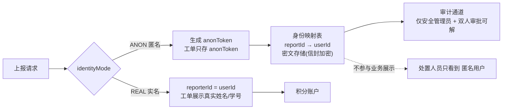

**关键机制**

1. **业务侧彻底匿名**：工单、派单消息、处置记录、评价里只存 `anonToken`（随机 UUID），展示为"匿名师生"。责任部门、处置人员、宿管均**无法**关联到人。
2. **审计侧可追溯**：单独表 `anon_identity_map(report_id, user_id_cipher, key_version, created_at)`，`user_id_cipher` 用**信封加密**（数据密钥用 KMS/本机密钥加密，主密钥离线保管或由校方安全员持有）。
3. **解密必须留痕且受限**：解密操作需要"安全管理员 + 1 名审批人"双人授权，解密行为写入不可篡改审计日志（含操作人、原因、时间、目标工单），并**自动通知校方纪检/审计接口人**。
4. **匿名不参与积分**：文档明确"实名有效上报关联积分账户"，因此匿名不与积分挂钩，避免"匿名刷分"。
5. **防滥用**：匿名上报仍做频次限制（同一设备/账号/IP 每日上限，【设计建议】20 条/日）、内容风控（纯文本相似度去重、垃圾内容识别）；恶意匿名举报达到阈值时进入"重点关注"队列，必要时经审批走审计通道。
6. **前端不落身份**：匿名提交时，客户端**不传** userId，仅带登录态 token，服务端在网关侧完成身份解析后立即丢弃，避免 userId 进入业务日志。

> 法律提示（【需甲方确认】）：匿名+可追溯的组合需在《用户协议》《隐私政策》中明确告知"匿名仅对校内其他用户匿名，依法律或校规需配合调查时可按审批流程追溯"，否则存在合规瑕疵。

### 1.1.6 草稿与撤回误报

**草稿**

- 触发：用户填写过程中每 5s 自动存本地；退出/杀进程后可恢复。
- 存储：App 用 SQLite（`report_draft` 表），小程序用 Storage（限制 5 条，超出淘汰最旧）。
- 草稿内容：分类、描述、媒体本地路径、定位、身份选择、时间。
- 草稿**不上传服务端**（避免半成品数据进入统计口径），仅在本设备。

**撤回误报**

| 当前状态 | 允许动作 | 实现 |
|---|---|---|
| 草稿 | 删除 | 本地删除 |
| 已上报 / 待受理 | **撤回**（文档明确支持"撤回误报"） | 工单 → `CANCELLED`，联动删除未使用的媒体、撤销未发出的通知 |
| 已受理 / 处置中 | **不可直接撤回**，改为"申请撤销" | 生成撤销申请，责任部门确认后终止；避免上报人一句话让已出警的工单消失 |
| 待反馈 / 已归档 | 不可撤回 | — |
| 聚合从单 | 撤回从单不影响主单；若主单被撤，自动提升最早从单为主单 | 见 1.3 |

- 撤回必须记录 `cancelReason`（误报/重复/信息有误/其他），并计入"误报率"用于质量分析。
- 撤回**不扣分**（首次），但同一账号月内撤回 ≥3 次触发提示与人工提醒（【设计建议】）。

---

## 1.2 隐患分类与 AI 研判

### 1.2.1 模型选型：三条路线与取舍

【文档】要求：AI 图像识别做**隐患类型初步归类**（消防通道占用 / 设施破损 / 违规停放 / 垃圾堆积），输出**置信度**，支持**人工复核纠偏**，且"仅轻量非敏感识别"。

| 路线 | 做法 | 优点 | 缺点 | 结论 |
|---|---|---|---|---|
| A. 开源预训练 + 私有化微调 | YOLOv8/RT-DETR（检测）+ ResNet/EfficientNet（分类）本地训练部署 | 数据不出校、推理成本低、可控可解释、可离线 | 需自建标注与训练能力；跨场景泛化弱 | **主路线** |
| B. 视觉大模型 API（公网） | 调外部多模态 API 做零样本分类 | 冷启动快、语义理解强 | **违反"数据不出校"**；按次计费；延迟不可控；无法私有化 | **不可用于主链路** |
| C. 私有化视觉大模型 | 校内 GPU 部署开源 VLM（如 Qwen-VL 类）做兜底/复核辅助 | 数据不出校、语义强、可解释性描述好 | 显存与算力要求高、单次推理慢 | **可选增强层** |

**推荐组合：A 为主 + C 为辅 + B 仅作离线评测参照**

- 主链路：**检测模型定位隐患区域 → 分类模型给类型 → 置信度融合**。检测的价值在于"画框"，让复核人员一眼看到模型看的是哪里，比纯分类可解释性强得多。
- 类型映射（4 个文档标签 + 业务类别）：注意文档的**"上报分类"（4 类：安全隐患/可疑人员/设施损坏/紧急求助）与"AI 识别标签"（4 类：消防通道占用/设施破损/违规停放/垃圾堆积）是两套不同维度**——前者是用户主观选择，后者是模型客观识别，二者必须分开存储，不能混用（这是文档中最容易被开发做错的一处，界面示例也印证了：类型列=消防通道占用，状态=处置中）。

| AI 识别标签 | 父类（用于统计） | 典型检测目标 |
|---|---|---|
| 消防通道占用 | 安全隐患 | 杂物堆、电动车、货架 |
| 设施破损 | 设施损坏 | 破损路面、坏灯、断栏杆、漏水 |
| 违规停放 | 安全隐患 | 机动车/电动车占道 |
| 垃圾堆积 | 安全隐患 | 垃圾堆、垃圾桶满溢 |
| （兜底）其他/无法识别 | — | 交由人工归类 |

**置信度融合公式**【设计建议】：`score = 0.7 × 检测框置信度 + 0.3 × 分类置信度`；多框取最高分框，并保留 top-3 结果供复核选择。

### 1.2.2 训练数据来源与标注

**冷启动（P0 阶段）**

1. 公开数据集筛选与场景适配（消防通道、垃圾堆积、道路破损类公开数据）。
2. **校内实拍采集**：由保卫处/后勤按"点位清单"补拍每个楼栋的典型隐患与正常对照（**正常对照样本很关键**，否则模型会把"走廊"一律判成"占用"）。
3. 历史工单（若学校已有纸质/表格记录，做数字化后作为弱标注）。

**规模建议**【设计建议】：每类 ≥800 张有效样本，含正负样本比 1:2；覆盖白天/夜间、室内/室外、不同楼栋。

**标注规范**

- 双人独立标注 + 第三人仲裁，`IoU/类别一致率 ≥0.9` 才入库。
- 标注字段：`imageId / bbox / label / 遮挡程度 / 拍摄场景 / 标注人 / 复核状态`。
- 建立**标注手册**：明确"消防通道占用"边界（如"临时摆放 1 个纸箱是否算占用"）——这类边界不定义清楚，模型与人工会长期打架。
- 数据版本化：`dataset_v1 / v2`，每次训练固定数据集版本，保证可复现。

**数据合规**：采集时须避免拍到清晰人脸/车牌；入库前做**人脸与车牌模糊化**（见 1.2.5），并在采集告知书中说明用途。

### 1.2.3 置信度阈值与"低置信度转人工"

**三档策略**【阈值需甲方确认，下列为建议初值】

| 置信度区间 | 策略 | 工单表现 |
|---|---|---|
| ≥ 0.85 | **自动归类**，标记"AI 已识别" | 台账直接显示标签 + 置信度；无需人工介入即可派单 |
| 0.60 – 0.85 | **AI 建议 + 人工确认**（强制复核） | 显示"待复核"，派单前须处置管理员确认或修改 |
| < 0.60 | **转人工**，AI 结果仅作参考不作结论 | 显示"AI 无法确定"，由人工选类；不阻塞派单（用用户上报分类兜底） |
| 无图 / 图不可用 | 直接人工 | `aiStatus=SKIPPED` |

**关键设计**

- **置信度随单流转**（文档要求）：`ai_result` 与工单解耦存储，但工单详情每次读取实时带出；人工修改后写 `reviewedLabel`，原 `aiLabel` 保留，二者并存（可对比，形成训练样本）。
- **不因 AI 阻塞主流程**：AI 是"加速器"不是"关卡"。超时（【设计建议】8s）即降级为"待人工识别"，工单照常受理派单。
- **模型版本随结果落库**：`modelVersion` 必须记录，否则后期无法解释"为什么当时判成垃圾堆积"。

### 1.2.4 人工复核纠偏如何回流成训练数据

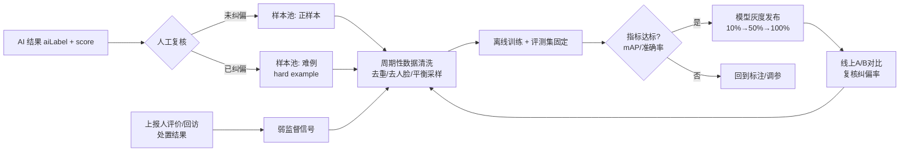

**落地要点**

1. **纠偏即样本**：人工每改一次标签，系统自动生成一条 `(imageId, aiLabel, correctedLabel, reviewerId)` 记录，**不需要额外标注成本**——这是最廉价的高质量数据来源。
2. **难例优先**：`correctedLabel ≠ aiLabel` 的样本进入"难例集"，训练时**过采样 3 倍**。
3. **闭环节奏**【设计建议】：每季度一次增量训练；模型上线走灰度（10% 流量 → 观察 1 周 → 50% → 100%），指标看**复核纠偏率**（越低越好）与**转人工率**。
4. **防数据泄漏**：训练集/验证集按"楼栋/时间段"切分，不能随机切分（否则同一场景的相似图会同时出现在训练与验证集，指标虚高）。
5. **人工标注工具**：内置轻量标注页（管理端"模型反馈"视图），支持复核人员在工单详情里一键纠正并勾选"加入训练集"。

### 1.2.5 为什么声明"仅轻量非敏感识别、不涉及人脸"

这既是**合规策略**也是**技术策略**，必须在架构上真实落实，否则一旦被审计质疑，整个系统的合法性都会被推翻。

**合规动因**

- 《个人信息保护法》将**人脸识别信息列为敏感个人信息**，处理需"单独同意 + 必要性 + 严格保护"，校园场景极易触碰红线（学生属于弱势群体，监管敏感度高）。
- 若系统声称"识别隐患"，实际却提取人脸特征/做人脸比对，属于**超范围处理**，风险极高。
- 声明"不涉人脸"可显著降低：单独同意成本、等保测评压力、家长/学生舆情风险、数据出境争议。

**技术保障（不是口号，要有工程手段）**

| 措施 | 实现 |
|---|---|
| 输入侧脱敏 | 推理前对人像区域做**模糊化/裁切**（用轻量人形检测，仅判断"这里有人"并高斯模糊，不提取任何特征） |
| 模型侧约束 | 模型输出空间只有"隐患类别 + 框"，**没有身份/人脸 embedding 头**；训练数据中不包含人脸标签 |
| 存储侧约束 | 人脸区域像素在入库前已模糊，原始未模糊图不落盘（或仅短期留存于加密临时区，24h 清理） |
| 接口侧约束 | 对外 API **不提供任何人脸相关字段/能力**；审计日志中不出现"人脸"字样 |
| 组织侧约束 | 与算法供应商的合同中明确"不得用于人脸识别/人群分析" |
| 可验证 | 提供《数据处理说明》与推理流水线截图，供等保/审计核查 |

> 注意：文档写的是"**仅轻量、非敏感识别，不涉及人脸等敏感数据**"。本文的理解是——**允许"检测到人形"用于脱敏，但不做"识别人是谁"**。若甲方认为连人形检测都不允许，则改为"整图下采样 + 仅保留非人区域"，需 **【需甲方确认】**。

### 1.2.6 推理服务与工单的异步解耦

AI 推理是**慢、重、可能失败**的能力，绝不能同步嵌在提交接口里。

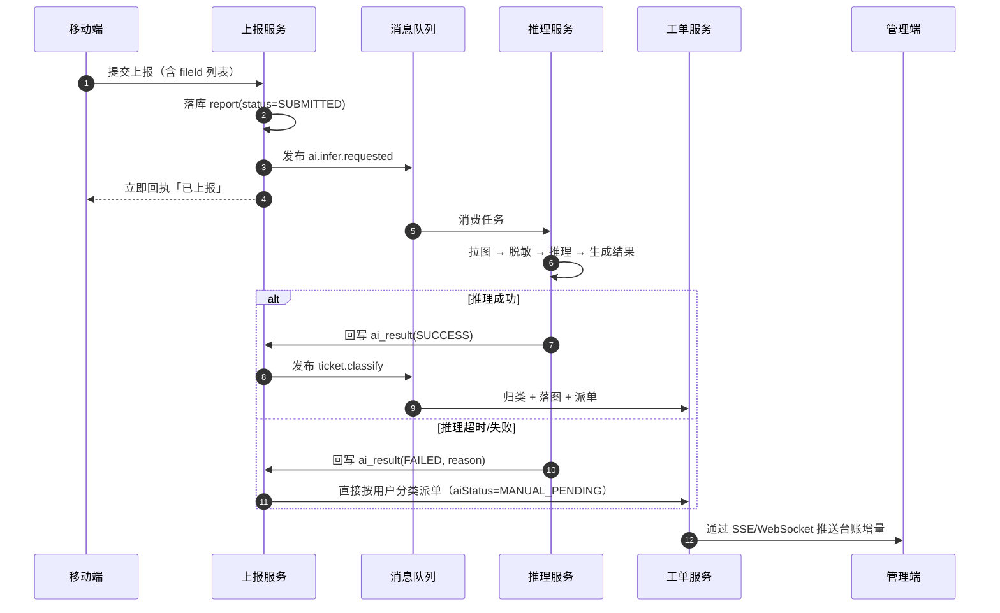

**设计要点**

| 问题 | 方案 |
|---|---|
| 任务重复消费 | 消息体带 `idempotencyKey = reportId + modelVersion`，推理结果表唯一索引 |
| 推理排队积压 | 独立队列 + 独立 worker 池（GPU 2–4 并发）；队列深度 >50 时告警，并**自动降级**为"仅缩略图推理"或跳过 AI |
| 结果乱序 | 以 `reportId` 聚合，后到结果覆盖前到（同 modelVersion 下），并记录 `revision` |
| 回调丢失 | 不用纯回调：采用"**结果表 + 轮询补偿 + 事件通知**"三保险，工单服务定时扫描 `aiStatus=PENDING 且 超过 N 分钟` 的记录重试 |
| 版本追溯 | 每条结果存 `modelVersion / inferAt / latencyMs / rawTop3` |
| 灰度 | 请求按 `reportId hash % 100` 分流到不同模型实例，结果标注 `abGroup` |

---

## 1.3 去重聚合

【文档】"同一时空、同类事件的多人上报自动去重聚合为同一工单（如'已合并 3 条'），避免重复派单与工单泛滥。"

### 1.3.1 判定模型：四维加权

单一维度都会误判，必须**多维打分 + 阈值**。

| 维度 | 判定方式 | 权重（建议） | 说明 |
|---|---|---|---|
| 空间 | **GeoHash / S2 网格**：同网格或相邻网格，且**球面距离 ≤ R**（室外 80m / 室内 30m） | 0.35 | 用网格做粗筛（DB 索引友好），再用距离精算 |
| 时间 | 上报时间差 ≤ **T**（建议 30 分钟；同一天同一处反复报可放宽到 2h） | 0.25 | "时空"是文档原词，必须先满足 |
| 类型 | 分类一致（同为安全隐患）且 **AI 标签一致**（同为"消防通道占用"） | 0.20 | 类型不同直接不聚合（一个报火警一个报垃圾，不能合并） |
| 图像相似 | 图片 embedding 余弦相似度（CLIP/ViT 向量）≥ 0.90 | 0.15 | 用 pgvector/Milvus 做近邻检索 |
| 文本相似 | 描述文本相似度（SimHash/编辑距离）≥ 0.8 | 0.05 | 辅助 |

**判定规则**

```
候选集 = 同一 GeoHash 邻域(9宫格) ∧ 状态 ∈ {待受理, 已受理, 处置中} ∧ 类型一致
对每个候选 c：
  score = 0.35*S_space + 0.25*S_time + 0.20*S_type + 0.15*S_img + 0.05*S_text
若 max(score) ≥ 0.78 → 聚合到该候选所属聚合组
否则 → 新建聚合组（自己当主单）
```

- **硬门槛**：`S_space` 或 `S_type` 为 0 时直接否决（防止"相距 2 公里的两个垃圾堆"被合并）。
- **阈值可配置**：管理端"接口管理/规则配置"里暴露 `R / T / 相似度阈值`，便于学校按校园密度调参（大学城大校区与中小学差别很大）。
- **可解释**：聚合记录里保存 `matchScore` 与各维度分值，供人工"拆分"时判断。

### 1.3.2 主单 / 从单关系

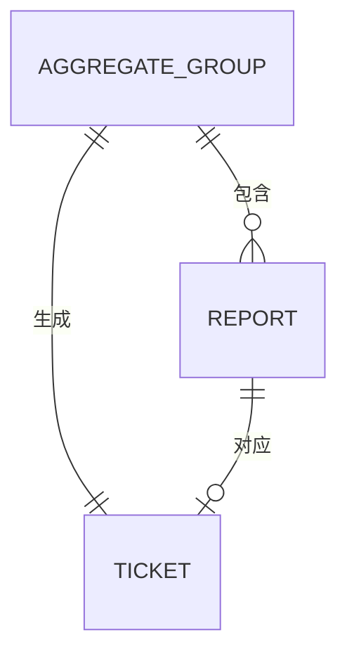

| 概念 | 定义 |
|---|---|
| 聚合组（AggregateGroup） | 一次"同一隐患事件"的所有上报集合，有独立 ID、`mainReportId`、`memberCount`、`status` |
| 主单（Main Report） | **最早提交**的那条上报；其内容作为工单主体（图片最多、描述最全） |
| 从单（Sub Report） | 后续被聚合进来的上报；**不单独生成工单**，仅贡献"人数"与"补充材料" |

**为什么用"主单+从单"而不是"合并成一条"**：原始上报是证据，必须全部保留（可追溯、可统计"多少人次关注同一隐患"），但**只对外产生 1 个工单**，避免重复派单。这也正是文档"已合并 3 条"的含义——**3 条上报，1 个工单**。

**工单侧展示**

- 台账"来源"列显示 `多人上报 · 已合并 3 条`（对应文档图 3）。
- 详情页显示"共 3 位师生上报"，可展开看每条的时间与补充材料（匿名者显示"匿名师生"）。
- 处置人员看到的图片是**主单图片 + 从单补充图片**的合集（去重后），避免漏看关键视角。

### 1.3.3 新上报如何挂到已有聚合组

1. **实时挂接**：上报提交 → 落库 → 同步执行"聚合判定"（轻量，纯 DB + 向量检索，<100ms）→ 命中则 `INSERT INTO aggregate_member`，`memberCount+1`，**不新建工单**，仅给工单追加一条"新增 1 人上报"动态。
2. **异步补挂**：AI 结果晚于聚合判定到达时（先按用户分类聚合，AI 出结果后发现标签不一致）→ 触发"**重新评估**"：若与聚合组标签冲突，则**拆出**为独立上报并新建工单；若一致则更新置信度。
3. **主单失效处理**：主单被撤回/撤销 → **自动提升最早的有效从单为主单**，工单内容随之切换（图片/描述），并在工单时间轴记录"主单变更"。
4. **聚合窗口关闭**：工单进入 `待反馈` 或 `已归档` 后，**不再接受新挂接**；新上报即使地理/类型相同也新建工单（否则历史工单会被无限追加，统计失真）。
5. **人工拆分/合并**：处置管理员可"拆出某条上报"或"手动合并两个工单"，操作需填原因并写审计日志。这是**误判的兜底**，必须做——算法不可能 100% 准。

---

## 1.4 数字孪生落图

【文档】"自动解析上报的 GPS 坐标，在数字孪生大屏对应位置精准落图"。

### 1.4.1 坐标转换链路

```
手机 GPS (WGS84)
   │ ① 若使用高德/腾讯底图 → WGS84→GCJ02（国测局偏移）
   ▼
GCJ02（或保持 WGS84，取决于底图）
   │ ② 校园局部坐标系（平面直角坐标，单位米）
   │    方法：至少 4 个控制点做四参数/七参数拟合（推荐 6–9 个点，覆盖四角+中心）
   ▼
校园坐标 (x, y, z)   z = 楼层 × 层高 + 高程修正
   │ ③ 孪生引擎场景坐标（Unity/UE/Three.js 世界坐标）
   │    偏移 + 旋转 + 缩放（由孪生平台提供标定参数）
   ▼
三维场景点位 (X, Y, Z) + 楼层图层
```

**关键点**

1. **坐标系必须显式存储**，禁止"默认就是 WGS84"的隐式假设（这是落图偏移 50–500m 的最常见原因）。每条上报存 `coordType`。
2. **控制点标定**：与孪生平台一起在现场用 RTK 或已知点标定，**标定参数版本化**（`calibrationVersion`），换版本后历史点位按当时版本换算，避免"老工单跑到新楼里"。
3. **转换在服务端统一做**（`geo-service`），客户端与大屏都不做转换，保证唯一真源。
4. **精度分层**：`accuracy ≤ 30m` 正常落图；`30–100m` 落图但标"定位精度较低"；`>100m` 或手动定位 → 落到"楼栋中心点"，并标注"位置为楼栋级"。

### 1.4.2 楼层与室内定位

校园隐患大量在**楼内**（消防通道、走廊、宿舍），纯 GPS 在室内不可用。

| 场景 | 方案 | 说明 |
|---|---|---|
| 室外 | GPS 直接落图 | — |
| 楼内、有 WiFi 指纹库 | WiFi 指纹定位（需提前采集 AP 指纹） | 成本高，**建议 P2 再做** |
| 楼内、无指纹 | **用户选择楼栋 + 楼层 + 位置描述**（必填下拉） | 最务实，覆盖率 100% |
| 楼内、蓝牙信标 | BLE 信标（重点楼栋试点） | 成本较高，可选 |
| 高程辅助 | GPS altitude 与楼栋基准高程差 ÷ 层高 ≈ 楼层 | 仅作**推荐值**，仍需用户确认 |

> 结论：**P0 用"用户选楼层 + GPS 平面坐标"组合**，落图时 `z = 楼层 × 层高`；P2 再叠加 WiFi/BLE 提升室内精度。文档未要求室内定位精度，此处为设计补全。

### 1.4.3 三维引擎侧如何接收点位：接口 vs SDK

| 方式 | 适用 | 优点 | 缺点 |
|---|---|---|---|
| **HTTP 接口推送点位**（推荐主用） | 常态点位、热力聚合结果 | 解耦、跨引擎、易缓存、易审计 | 实时性受轮询间隔限制（可 SSE 补足） |
| **SDK 嵌入**（JS SDK / Unity SDK） | 高频交互、点位点击联动、视角飞行 | 体验好、能力强 | 与引擎版本耦合、升级需重新集成 |
| 消息订阅（MQ/WebSocket） | 实时新增隐患"冒泡" | 实时 | 需大屏侧长连接治理 |

**推荐组合**：**接口为主 + SDK 为辅**

- 点位数据：`GET /open/v1/twin/points?bbox=&status=&type=&zoom=` 返回聚合后的点位（服务端按 zoom 做网格聚合，避免万级点位卡死前端）。
- 实时新增：WebSocket/SSE 推送 `point.created` 事件，大屏做"冒泡动画"。
- 点击联动：大屏调 `GET /open/v1/twin/points/{id}` 拿工单摘要；若需深度交互（如三维内嵌工单面板），用**孪生平台提供的 JS SDK** 挂载本系统 H5 微页面（iframe + postMessage 通信）。
- **SDK 级对接的体现**：本系统提供 `hazard-twin-sdk`（JS/TS），封装"坐标转换、点位拉取、事件订阅、图层控制"，孪生平台只需 `npm i` 即可接入，无需理解本系统内部模型——这正是文档"SDK 级对接"的具体落地形态。

### 1.4.4 热力图聚合与聚合打点

- **网格聚合**：按当前 zoom 选择网格层级（如 zoom 12 → 500m 网格，zoom 16 → 50m 网格），服务端 `GROUP BY geohash_prefix`，返回 `{gridId, center, count, topType, riskLevel}`。
- **前端渲染**：≤500 点直接打点；>500 点走聚合气泡（数字圆点）；热力图用独立图层（按 `count` 加权）。
- **性能**：热力数据预计算到 `heatmap_snapshot` 表（每 5 分钟刷新一次），大屏直接读快照，避免每次全表扫描。
- **口径**：热力图默认按"**未归档工单数**"着色（存量风险），可切换"近 7 天新增"（增量风险）。口径必须在界面上写明，否则校领导会问"为什么这个数是 13"。

---

## 1.5 自动派单

【文档】"结合数字孪生定位与隐患类型自动派单至对应责任部门（保卫处 / 后勤 / 宿管等）"。

### 1.5.1 责任映射规则

**三段式规则：类型 × 区域 → 部门**

| 隐患类型（AI 标签） | 默认责任部门 | 说明 |
|---|---|---|
| 消防通道占用 | 保卫处 | 消防归保卫 |
| 违规停放 | 保卫处 | 交通/秩序 |
| 设施破损 | 后勤 | 维修 |
| 垃圾堆积 | 后勤（教学区）/ 宿管（宿舍区） | **依赖区域判定** |
| 可疑人员 | 保卫处 | 安全事件，优先级最高 |
| 紧急求助 | 保卫处（同时触发人工电话核实） | 见下方特殊处理 |
| 其他/未识别 | 兜底部门（可配置，建议保卫处） | — |

**规则存储**：不写死在代码里，用**规则表 + 优先级**：

```
dispatch_rule(id, priority, match_type, match_area, match_time, dept_id, assign_mode, enabled)
-- 例：(10, 设施破损, 宿舍区*, 全天, 宿管, AUTO)
--     (20, 设施破损, *,      全天, 后勤, AUTO)   ← 兜底
```

- 匹配顺序：`priority` 升序，先命中先得；都不命中走 `DEFAULT`。
- **匹配条件可扩展**：类型、区域（楼栋/网格/校区）、时间段（夜间垃圾堆积可能归值班保洁）、上报分类、是否紧急。
- 配置界面放在管理端"接口管理/规则配置"下（文档已有 4 个视图，规则配置可作为"接口管理"的子页，**不新增顶级菜单**，保持与文档一致）。

### 1.5.2 区域归属（部门 / 网格）

- **网格模型**：校区 → 片区 → 楼栋 → 楼层 → 点位（五级）。每个网格绑定 `ownerDeptId`（归属部门）与 `dutyDeptIds`（协同部门）。
- **点位反查**：上报坐标 → `geo-service` 做**点在多边形内（Point-in-Polygon）** 判定 → 得到 `gridId` → 得到 `ownerDeptId`。射线法 + R-Tree 索引，单次 <5ms。
- **楼栋内上报**：用户选了楼栋楼层，直接用 `buildingId` 映射网格，不依赖坐标（室内坐标不可靠）。
- **边界情况**：坐标落在两个网格交界 → 取包含该点的最小网格；落在校园外 → 归"校园周边"虚拟网格，派保卫处。

### 1.5.3 值班表与负载均衡

**（1）值班表**

```
duty_schedule(deptId, date, shift, userId, phone, channel_pref, backupUserId)
```

- 派单时先查**当前时段的在班人员**（`now()` 落在 shift 区间内）。
- 无值班表配置 → 派到部门"默认接收人"（部门负责人）。
- 夜间/节假日按 `duty_calendar` 切换（【设计建议】支持导入学校校历与节假日）。

**（2）负载均衡**

在候选人中按"**未结工单数升序 + 最近派单时间最久优先**"选择：

```
score = activeTicketCount * 1.0 + (now - lastAssignedAt)/3600 * 0.5
取 score 最小者
```

- 同一人连续派单上限（【设计建议】同时在办 ≤5 单），超出转下一人。
- 部门整体超载（未结 > 阈值）→ 派单消息同时抄送部门负责人，并标记"部门超载"。

### 1.5.4 转派与退回

| 动作 | 触发者 | 规则 |
|---|---|---|
| **转派** | 责任部门/处置管理员 | 目标部门须存在且启用；转派后重新计时（原计时保留为"已耗时"）；转派次数上限（【设计建议】3 次），超出升级至校级 |
| **退回** | 责任部门 | 必须选择退回原因（非本部门职责 / 信息不足 / 重复工单 / 位置错误）；退回后回到"待派单"，由调度员重新派；**退回不计入部门考核**（需甲方确认） |
| **申请协助** | 责任部门 | 主责不变，拉协同部门入单（如后勤修路需保卫处封路） |

> 业务风险：退回是"甩单"的温床。必须用"退回原因分类 + 退回率看板"约束；连续退回 3 次自动升级到校级调度，避免工单在部门间空转（这是校园系统落地最常见的失败模式）。

### 1.5.5 派单失败的兜底

| 失败场景 | 兜底 |
|---|---|
| 规则无匹配 | 派"兜底部门"（配置项），并生成"待完善规则"待办给管理员 |
| 部门无在班人员 | 派部门默认接收人 + 短信兜底 |
| 通知全部失败（企微/钉钉/短信都挂） | 工单进入"**待人工调度池**"，管理端顶部红点提醒；同时记录 `notifyFailed` 供运维排查 |
| 派单服务异常 | MQ 重试 3 次 → 失败进死信队列 → 定时任务补偿扫描 `status=待派单 且 超 2 分钟` 重派 |
| 坐标缺失 | 按"上报分类"派默认部门（如紧急求助 → 保卫处），不阻塞 |

---

## 1.6 工单状态机

### 1.6.1 完整状态定义

| 状态码 | 中文 | 含义 | 是否终态 |
|---|---|---|---|
| `DRAFT` | 草稿 | 仅本地，不入库（服务端可选存） | 否 |
| `SUBMITTED` | 已上报 / 待受理 | 已提交，等责任部门受理（对应文档"待受理"） | 否 |
| `ACCEPTED` | 已受理 | 部门确认接单（对应"受理"节点） | 否 |
| `PROCESSING` | 处置中 | 现场处置（对应"处置中"） | 否 |
| `PENDING_FEEDBACK` | 待反馈 | 处置完成，待反馈上报人（对应"待反馈"） | 否 |
| `FEEDBACKED` | 已反馈 | 已向上报人反馈结果（对应"反馈"） | 否 |
| `ARCHIVED` | 已归档 | 闭环归档（对应"归档"） | **是** |
| `REJECTED` | 已退回 | 退回重派（回到待派单） | 否 |
| `CANCELLED` | 已撤销 | 上报人撤回 / 部门判定误报 | **是** |
| `SUSPENDED` | 挂起 | 需等待外部条件（如需专业公司维修、需立项） | 否 |
| `MERGED` | 已合并 | 作为从单被聚合（不独立存在工单） | **是** |

> 映射到文档：界面上只展示**五个主状态**（待受理/处置中/待反馈/已归档 + 已上报），`SUSPENDED/REJECTED` 作为**子状态**展示（如"处置中（挂起）"），避免与文档口径冲突。

### 1.6.2 合法迁移

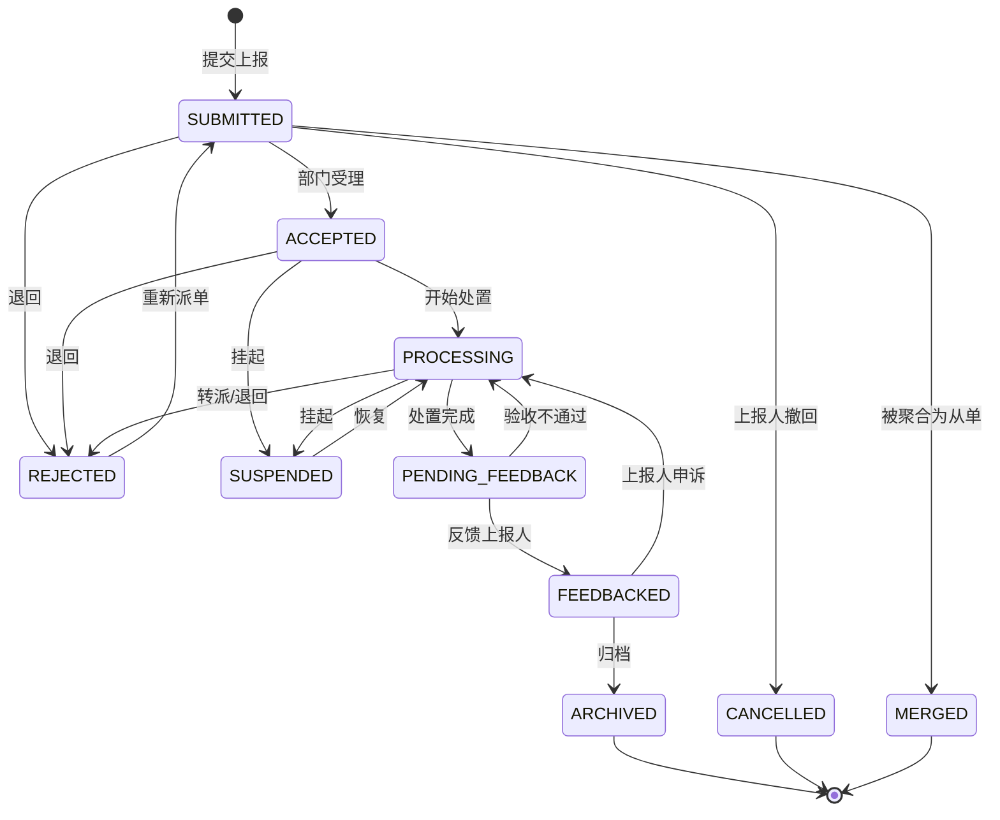

**迁移守卫（Guard）**

| 迁移 | 前置条件 |
|---|---|
| → ACCEPTED | 必须有受理人；工单未超时撤销 |
| → PROCESSING | 必须有处置负责人 |
| → PENDING_FEEDBACK | 必须上传**处置后照片**（≥1 张，【设计建议】）与处置说明 |
| → FEEDBACKED | 必须已发送反馈（任一通道成功） |
| → ARCHIVED | 反馈后满 N 小时无申诉（【设计建议】24h）或上报人已评价 |
| → CANCELLED | 仅 `SUBMITTED/ACCEPTED` 允许；`PROCESSING` 及之后需走"申请撤销"审批 |
| → MERGED | 聚合判定命中，且目标工单不在终态 |

### 1.6.3 超时计时与多级升级

**计时模型**

- 每个阶段独立计时：`stageEnterAt`、`stageDeadline`、`remainingSeconds`、`pausedMs`（挂起期间不计时）。
- 计时基于**工作日历**（可配置：7×24 或 工作时间 8:00–18:00），否则"周末不上班"会导致周一集体超时误报。
- 时限配置（**全部【需甲方确认】**，下列为设计建议）：

| 阶段 | 建议时限 | 说明 |
|---|---|---|
| 待受理 → 受理 | 30 分钟（紧急求助 5 分钟） | 校园事件响应要快 |
| 受理 → 处置完成 | 4 小时（普通）/ 24 小时（需外修） | 可分类型配置 |
| 处置完成 → 反馈 | 2 小时 | — |
| 反馈 → 归档 | 24 小时（自动归档） | — |

**多级升级（Escalation）**

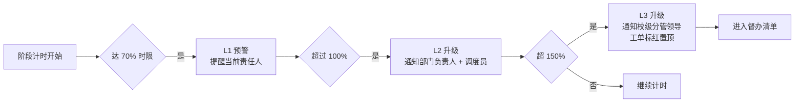

- 每次预警/升级写 `escalation_log`，并计入"超时率"统计。
- 升级**不改状态**，只改 `priority` 与通知对象；避免状态机爆炸。
- 文档图 3 里"受理 09:41"旁挂的橙色标签"**超时预警/升级提醒**"正是此机制的可视化，界面上必须能点开看到"已升级至谁、何时"。

### 1.6.4 退回重办、撤销、归档与冻结

- **退回重办**：`PROCESSING → REJECTED → SUBMITTED`，保留全部历史（不删记录），`reopenCount+1`。
- **撤销**：上报人撤回（限早期）→ `CANCELLED`；部门判定误报 → `CANCELLED` 并通知上报人"经核实为误报"，**误报不扣积分但计入误报率**。
- **归档**：`ARCHIVED` 后数据**只读**（`frozen=true`），任何人不可编辑；需要修正只能"新增说明"（追加到时间轴）。
- **冻结（合规）**：涉及投诉/纠纷的工单可"证据冻结"——禁止任何删除与媒体清理任务触碰，保留期限延长（【需甲方确认】，建议 ≥3 年）。

---

## 1.7 通知触达

【文档】"企业微信、钉钉、短信等多渠道即时触达，派单与反馈直达责任人"。

### 1.7.1 三通道统一抽象

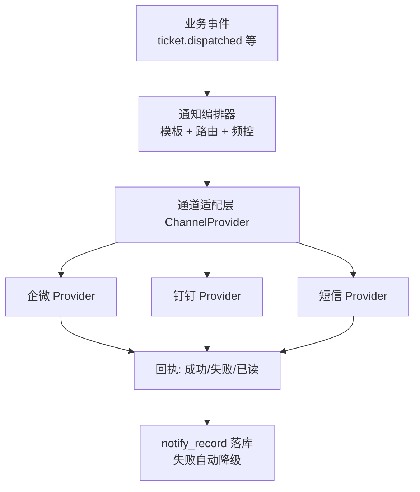

**统一接口**

```java
public interface ChannelProvider {
    ChannelType type();                                  // WECOM / DINGTALK / SMS
    SendResult send(NotifyMessage msg);                  // 单发
    BatchResult batchSend(List<NotifyMessage> msgs);
    boolean supports(Receiver receiver);                 // 是否可触达（如未绑定企微则 false）
    int priority();                                       // 降级顺序
}
```

- 业务侧只调用 `notifyService.send(event, receivers, templateCode, vars)`，**不感知通道**。
- 新增通道（如"校园 APP 推送"）只需实现 Provider 并注册，不改业务代码。

### 1.7.2 模板与可达性降级

**模板**：`template(code, channel, title, content, variables, version)`，按通道分别维护（短信要短、企微可带卡片与跳转链接）。

**降级链**：`企微 → 钉钉 → 短信`

| 判定 | 行为 |
|---|---|
| 接收人已绑定企微且企微发送成功 | 结束 |
| 企微未绑定 / 发送失败（超时 3s） | 尝试钉钉 |
| 钉钉失败 | 发短信（含短链，指向 H5 详情页） |
| 短信也失败 | 标记 `ALL_FAILED`，工单进"待人工调度池"+ 管理端红点 |
| 紧急求助类 | **并行全通道发送**（不走降级链），并触发电话外呼（【设计建议】） |

**可达性**：维护 `user_channel_binding(userId, channel, externalId, bindStatus, lastActiveAt)`；发送前先查绑定关系，避免无效调用浪费配额。

### 1.7.3 防骚扰与频控

| 规则 | 说明 |
|---|---|
| **合并通知** | 同一工单 5 分钟内多次状态变更 → 合并为一条"工单有新进展"（避免处置过程中刷屏） |
| **静默时段** | 22:00–07:00 非紧急工单不发短信（仅站内信），紧急求助除外（【需甲方确认】） |
| **日频上限** | 单用户短信 ≤10 条/日，超出转站内信 + 次日汇总 |
| **去重键** | `dedupKey = ticketId + eventType + receiverId`，24h 内不重复发送 |
| **退订** | 非必要通知支持"免打扰"开关（但派单给责任人的通知不可退订） |
| **审计** | 每条通知记录模板、通道、结果、耗时、失败原因，可追溯到"谁在何时收到了什么" |

---

## 1.8 积分与激励

【文档】"实名有效上报关联积分账户""对有效上报给予积分奖励，支持积分规则可配置""对接评优、文明宿舍、志愿服务时长，支持排行榜与荣誉展示"。

### 1.8.1 "有效上报"如何判定（防刷分）

这是积分体系成败的关键。**默认不给分，满足条件才给分**。

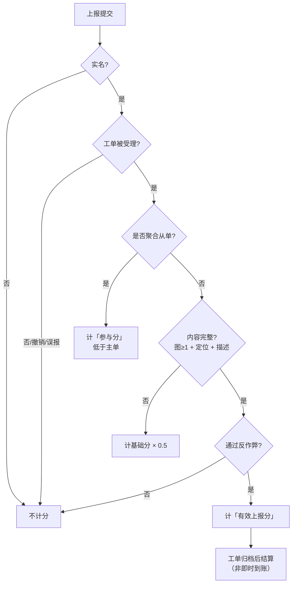

**判定规则（可配置）**

| 条件 | 建议值 | 说明 |
|---|---|---|
| 必须实名 | 是 | 文档明确"实名关联积分" |
| 工单必须被受理 | 是 | 未受理不计分 |
| 非误报/非撤销 | 是 | 误报不计分 |
| 主单 vs 从单 | 主单全额，从单 30% | 防止"同一隐患人人有份"式刷分 |
| 内容完整度 | 图 ≥1 张 + 有坐标 + 描述 ≥10 字 | 缺项打折 |
| 单日上限 | 3 条计分/日 | 超出不重复计分 |
| 同设备/同 IP 频控 | 单设备 ≤20 条/日 | 防脚本 |
| 同一人重复报同一聚合组 | 只计首次 | 核心防刷规则 |
| 结算时点 | **归档后** | 避免"报了就有分"导致乱报 |

### 1.8.2 积分规则可配置

采用**规则表 + 表达式**，不改代码即可调：

```
point_rule(id, code, name, trigger_event, base_point, multiplier_json, condition_expr, daily_limit, enabled, effective_from)
-- 例：有效上报 base 10，图片≥3 张 ×1.2，紧急求助 ×1.5，夜间 ×1.1
```

- `condition_expr` 用受限表达式（如 SpEL/AVIATOR 白名单），**禁止执行任意代码**。
- 规则变更**必须留版本与生效时间**，历史流水按当时规则结算（不能回溯改分）。

**积分账户与流水（复式记账思路）**

- `point_account(userId, balance, totalEarned, totalSpent, frozen)` —— 只存汇总。
- `point_transaction(id, userId, bizType, bizId, delta, balanceAfter, ruleVersion, status)` —— **流水是唯一真相**，余额可由流水重算校验。
- 幂等：`(bizType, bizId)` 唯一索引，同一工单不重复加分。
- 冻结/解冻：归档前 `frozen`，归档后转 `available`（对应"归档后结算"）。

### 1.8.3 与评优 / 文明宿舍 / 志愿时长的对接

| 场景 | 对接方式 | 说明 |
|---|---|---|
| 评优（学生/班级） | 提供 `GET /open/v1/points/summary?scope=class&period=` 或**月度数据推送** | 推给学工系统，避免本系统变成"评优系统" |
| 文明宿舍 | 按 `buildingId + roomId` 维度聚合积分，输出宿舍排名 | 需要上报时能关联宿舍号（可在楼栋选择后选房间，【设计建议】） |
| 志愿服务时长 | **换算规则可配置**（如 100 积分 = 1 小时），生成"志愿时长兑换单"供团委审核 | 不直接写入志愿系统，走审批，避免合规风险 |
| 排行榜 | 个人榜 / 班级榜 / 学院榜 / 宿舍榜；日/周/月/学期 | Redis ZSet 实时榜 + 定时落库 |

> 边界：本系统**只负责产生与兑换积分**，**不负责评优评定**。评优规则属学工部门，强行内置会导致每所学校都要定制，交付成本失控。

---

## 1.9 数据沉淀与分析

【文档】"上报数据按区域、类型、时段沉淀分析""统计报表与热力图分析，反哺安全管理决策""今日上报数 / 按类型占比 / 校园区域隐患热力图"。

### 1.9.1 报表与热力图

| 报表 | 维度 | 用途 |
|---|---|---|
| 今日概览 | 上报数、受理数、处置中、超时数、归档数 | 管理端首屏（对应文档 3 个指标卡） |
| 类型分布 | 上报分类 × AI 标签（**两套维度分开统计**） | "按类型占比小环图" |
| 区域热力 | 楼栋/网格 × 未归档工单数 | "校园区域隐患热力缩略图" |
| 时段分布 | 小时 × 星期 | 排班与巡查优化 |
| 部门绩效 | 受理时长、处置时长、超时率、退回率、满意度 | 考核依据（分值【需甲方确认】） |
| 重复上报率 | 聚合组内平均成员数 TOP 榜 | 识别"高频隐患点位" |
| AI 质量 | 转人工率、纠偏率、平均置信度 | 模型迭代依据 |

### 1.9.2 指标口径（必须先定义，否则数据打架）

```
今日上报数 = count(report where date(createdAt)=today and status != DRAFT)
类型占比   = count(ticket by ticketType) / count(ticket)     ← 用上报分类，不用 AI 标签
热力图值   = count(ticket where status not in (ARCHIVED, CANCELLED) group by gridId)
平均处置时长 = avg(archivedAt - acceptedAt)  ← 明确是"受理到归档"，不是"上报到归档"
超时率     = count(超时工单) / count(已归档工单)  ← 分母口径必须固定
```

> 建议在界面上提供"口径说明"浮层（一个小问号），这是评审时最容易被追问的点。

### 1.9.3 离线与实时分离

| 层 | 技术 | 承载 |
|---|---|---|
| 实时 | 业务库 + Redis + 定时聚合（每分钟/每5分钟） | 首屏指标、热力快照、排行榜 |
| 离线 | 只读副本 / 数仓（可选 ClickHouse/Doris） | 月度报表、趋势分析、导出 |
| 明细查询 | 业务库 + 覆盖索引 | 台账分页、条件筛选 |

**单校数据量很小**（年工单量万级），**不需要上 Hadoop/Flink**。用"业务库只读副本 + 物化视图/预聚合表 + 定时任务"即可，这是私有化交付的成本关键——每多引入一个大数据组件，运维负担与故障面都成倍增加。

---

## 1.10 安全与私有化

### 1.10.1 账号权限分级模型

【文档】"账号权限分级管理"。文档未给矩阵，以下为**设计建议**，需甲方确认。

**RBAC + 数据权限（双维度）**

```
用户 → 角色（多对多）→ 权限点（菜单/按钮/接口）
用户 → 数据范围（全校 / 本部门 / 本网格 / 本人）
```

| 角色（建议） | 数据范围 | 关键权限 |
|---|---|---|
| 上报人（师生） | 本人 | 上报、查进度、追加材料、撤回、评价 |
| 处置人员 | 本部门工单 | 受理、处置、反馈、上传处置照片 |
| 部门负责人 | 本部门全部 | 转派、退回、督办、部门报表 |
| 调度员（保卫处值班） | 全校工单 | 派单、改派、合并/拆分、升级处理 |
| 处置管理员 | 全校 | 台账全量、规则配置、看板 |
| 系统管理员 | 系统配置 | 账号、组织、字典、通道配置（**不含业务数据导出**） |
| 安全审计员 | 审计日志 | 只读审计、解密审批（**与系统管理员分权**） |

**关键原则**

- **三权分立**：系统管理员（配系统）、业务管理员（管业务）、安全审计员（看审计）互不兼任——等保测评的基本要求。
- **数据权限下沉到 SQL**：不能只在前端隐藏，必须在 DAO 层强制注入 `deptId in (...)` 条件（用 MyBatis 拦截器/行级安全）。
- **敏感操作二次确认**：批量导出、解密身份、删除媒体、修改规则，需二次密码或审批。

### 1.10.2 操作留痕审计

- **审计范围**：登录/登出、数据查看（尤其含个人信息的详情）、导出、修改、删除、派单/转派/退回、解密、规则变更、权限变更。
- **日志内容**：`who / when / where(IP, UA) / what(资源类型+ID) / action / before / after / result`。
- **不可篡改**：审计表**只插不改不删**（数据库账号无 UPDATE/DELETE 权限）；每日对前一日日志做哈希链（`hash = SHA256(prevHash + 当日日志)`），哈希值单独存证。
- **留存**：≥6 个月（等保要求），建议 1 年（【需甲方确认】）。
- **查询**：审计员可按人/时间/资源检索；导出审计报告需审批。

### 1.10.3 加密传输与存储

| 层面 | 措施 |
|---|---|
| 传输 | 全站 HTTPS（TLS 1.2+），禁用弱套件；内部服务间 mTLS 或至少内网隔离；小程序要求域名备案 + HTTPS |
| 存储-数据库 | 磁盘加密（LUKS/云盘加密）+ 敏感字段列级加密（手机号、解密映射表） |
| 存储-对象 | MinIO 服务端加密（SSE-S3）+ 桶策略禁止匿名读 |
| 密钥 | 独立 KMS 或本地密钥文件（权限 600，仅服务账号可读）；**主密钥与数据密钥分离**；定期轮换 |
| 脱敏 | 列表页手机号 `138****1234`；日志中禁止打印手机号、坐标精度、身份映射 |
| 备份 | 加密备份，异机/异地（校内另一机房）保存 |

### 1.10.4 "数据不出校"的部署边界

**必须落在校内物理边界的组件**：

| 组件 | 是否可出校 | 说明 |
|---|---|---|
| 业务数据库 | ❌ | 校内 |
| 对象存储（图片/视频） | ❌ | 校内 MinIO |
| AI 推理 | ❌ | 校内 GPU 服务器，模型本地加载 |
| 数字孪生引擎 | ❌ | 校内 |
| 日志/监控 | ❌ | 校内（可用校内统一监控平台） |
| 短信网关 | ✅（仅手机号+模板变量） | 运营商必然出网，但**不发业务内容**（用短链代替） |
| 企微/钉钉 | ✅（仅消息体） | 走企业自建应用，消息含工单号与短链，不含照片与详细位置 |
| 地图底图 | ⚠️ | 若用公网地图瓦片，仅请求瓦片（不含业务数据）；**建议用离线瓦片**彻底闭环 |
| 代码仓库/CI | ✅ | 开发侧，不涉生产数据 |

**关键设计**：所有"必须出网"的通道，**只传最小必要信息**（工单号 + 短链 + 一句话），详情页在校内 H5 打开（VPN/内网），这样"数据不出校"才站得住。

### 1.10.5 个人信息与匿名的合规处理

- **最小必要**：只采集手机号（登录/通知）、姓名/学号（实名上报）、位置（业务必需）。
- **告知同意**：首次使用弹隐私政策，明确"采集什么、为什么、存多久、谁能看"。
- **匿名告知**：见 1.1.5 的法律提示。
- **删除权**：注销账号时，个人身份信息匿名化（保留工单业务数据，去除可关联字段）。
- **不出境**：全部校内，天然满足。
- **等保**：建议按**等保二级**设计（校园业务系统常见要求），三级需甲方明确（【需甲方确认】）。

---

## 1.11 与自研数字孪生平台、安全大脑的集成落地

【文档】"与本中心自研数字孪生平台、安全大脑采用统一数据模型深度集成，具备源码级 / SDK 级对接与二次开发能力，并由同一主体负责整体设计与联调。"

这三句话对应三种**不同的交付深度**，必须在合同与技术方案里分别定义清楚，否则验收时会被反复拉扯。

### 1.11.1 统一数据模型（最深的一层）

**做法：先建"校园安全领域模型"（Canonical Model），三方共用**

| 主数据 | 唯一真源（建议） | 说明 |
|---|---|---|
| 校区 / 建筑 / 楼层 / 房间 | **数字孪生平台** | 孪生平台有 BIM/倾斜摄影，天然是空间主数据源 |
| 空间点位（POI）与坐标标定参数 | **数字孪生平台** | 含 `calibrationVersion` |
| 组织 / 部门 / 人员 | **学校统一身份（CAS/统一认证）** | 本系统不重复建组织树 |
| 隐患类型字典 / AI 标签字典 | **安全大脑**（模型侧）+ 本系统同步 | 保证"模型输出的标签"与"业务字典"一致 |
| 工单 / 事件 | **本系统** | 工单是本系统核心资产 |
| 网格与责任归属 | **本系统**（可引用孪生空间层级） | 业务规则属本系统 |

**落地手段**

1. 定义 `canonical-schema`（JSON Schema / Protobuf），三方仓库共同引用（Git Submodule 或私有 npm/maven 包）。
2. **ID 规范统一**：`buildingId`、`gridId`、`deptId`、`ticketId` 的生成规则与长度三方一致，禁止各自生成再映射。
3. **字典同步任务**：安全大脑更新标签字典 → 推送 `dict.changed` → 本系统增量同步（保留历史映射，不能删旧标签，否则历史工单类型丢失）。
4. **对账机制**：每日比对"孪生平台楼栋数 vs 本系统楼栋数""安全大脑标签 vs 本系统地字典"，差异告警。

### 1.11.2 SDK 级对接（中等深度）

**本系统对外提供两套 SDK**

| SDK | 语言 | 能力 | 使用方 |
|---|---|---|---|
| `hazard-twin-sdk` | JS/TS | 点位拉取、坐标转换、事件订阅、图层控制、点击联动 | 数字孪生大屏（Web/Unity WebGL） |
| `hazard-open-sdk` | Java/Python | 工单创建/查询、字典同步、鉴权、重试、签名 | 安全大脑、工单/OA 系统 |

**SDK 必须包含的东西**（否则只是"薄封装"，谈不上 SDK 级）：

- 鉴权（AppKey/AppSecret + HMAC 签名 + 时间戳防重放）
- 自动重试与退避
- 幂等键支持
- 统一错误码与异常
- 请求/响应日志（可开关，脱敏）
- 版本兼容策略（`/v1` 稳定，新增字段不破坏旧版）

### 1.11.3 源码级对接（最深交付）

"源码级"意味着**甲方（或同一主体）可以拿到代码并二次开发**，不是只给 jar 包。

| 内容 | 交付物 |
|---|---|
| 全部业务源码 | Git 仓库（含提交历史）+ 构建脚本 |
| 部署脚本 | Dockerfile / Compose / K8s Helm Chart |
| 数据库脚本 | DDL + 初始化数据 + 升级脚本（Flyway/Liquibase） |
| 接口文档 | OpenAPI 3.0 + 示例 |
| 二次开发指南 | 模块边界、扩展点（SPI）、编码规范 |
| 联调环境 | 校内测试环境 + 联调账号 + Mock 服务 |

**扩展点设计（SPI）**：AI 识别、通知通道、坐标转换、派单规则、积分规则都应做成可插拔接口，二次开发时不改核心代码——这是"源码级"能否真正落地的前提。

### 1.11.4 "同一主体负责整体设计与联调"

**组织落地**

- 设**总架构师 1 名**（对三方架构有裁决权），三方各出 1 名技术接口人。
- **统一契约先行**：先定 OpenAPI + 数据模型 + 错误码，再各自开发；契约变更走评审。
- **统一环境**：一套联调环境（含孪生引擎、安全大脑 Mock、本系统），三方共用。
- **联调里程碑**：接口连通 → 数据一致 → 端到端场景（上报→AI→落图→派单→反馈）→ 性能压测。
- **问题单机制**：统一缺陷库，跨方问题由总架构师定责，避免"互相说是对方的问题"。

**技术风险控制**

| 风险 | 应对 |
|---|---|
| 孪生平台接口不稳定 | 本系统做**适配层 + 本地缓存**（楼栋/网格数据缓存 1h），孪生挂了不影响上报与派单 |
| 安全大脑推理不可用 | 降级为"用户分类直派"，AI 结果异步补齐（见 1.2.6） |
| 坐标标定参数变更 | 版本化 + 历史数据不重算 + 新点位用新版本 |
| 三方发版节奏不一致 | 契约版本化（`/v1`、`/v2` 并存），灰度切换 |

---

# 第二部分　系统架构梳理

## 2.1 分层架构与职责边界

```mermaid
flowchart TB
  subgraph L1["① 接入层 Access"]
    A1["微信小程序"]
    A2["手机 App"]
    A3["管理端 Web<br/>Vue3"]
    A4["数字孪生大屏<br/>SDK 嵌入"]
  end

  subgraph L2["② 应用层 Application / BFF"]
    B1["移动端 BFF<br/>聚合/裁剪/鉴权"]
    B2["管理端 BFF"]
    B3["开放 API 网关<br/>OpenAPI /v1"]
  end

  subgraph L3["③ 领域服务层 Domain"]
    C1["上报服务"]
    C2["工单服务"]
    C3["派单服务"]
    C4["处置与反馈服务"]
    C5["聚合去重服务"]
    C6["积分激励服务"]
    C7["统计分析服务"]
  end

  subgraph L4["④ 能力层 Capability"]
    D1["AI 推理服务<br/>GPU"]
    D2["孪生适配服务<br/>坐标/点位"]
    D3["通知服务<br/>企微/钉钉/短信"]
    D4["文件服务<br/>MinIO"]
    D5["规则引擎<br/>派单/积分"]
    D6["身份与权限<br/>RBAC"]
    D7["审计服务"]
  end

  subgraph L5["⑤ 数据层 Data"]
    E1["PostgreSQL<br/>业务库"]
    E2["Redis<br/>缓存/榜单"]
    E3["RabbitMQ<br/>异步消息"]
    E4["MinIO<br/>对象存储"]
    E5["pgvector<br/>图像向量"]
    E6["只读副本<br/>报表"]
  end

  subgraph L6["⑥ 基础设施 Infra"]
    F1["K8s / Docker"]
    F2["Prometheus + Grafana"]
    F3["ELK / Loki 日志"]
    F4["备份与容灾"]
  end

  L1 --> L2 --> L3 --> L4 --> L5
  L5 --- L6
```

**各层职责边界（谁不能做什么）**

| 层 | 职责 | 禁止 |
|---|---|---|
| 接入层 | 交互、采集、本地缓存、上传队列 | 不做业务规则判断（如"能否撤回"必须服务端判定） |
| 应用层（BFF） | 面向端的聚合、字段裁剪、鉴权、限流 | 不写业务规则；不直连数据库 |
| 领域服务层 | 业务规则、状态机、事务边界 | 不直接操作第三方（通过能力层） |
| 能力层 | 通用技术能力（AI/通知/文件/坐标） | 不含校园业务语义 |
| 数据层 | 持久化、缓存、消息 | 不含业务逻辑（存储过程仅限统计） |
| 基础设施 | 运行时、监控、备份 | — |

## 2.2 核心服务划分：为什么选"模块化单体"

**结论：P0–P1 采用"模块化单体 + 3 个独立进程"（业务主应用、AI 推理服务、通知服务），P2 视规模再拆分。**

**取舍理由**

| 维度 | 微服务 | 模块化单体 | 判断 |
|---|---|---|---|
| 交付形态 | 单校一套，K8s 编排复杂 | 一个 jar + 2 个边车进程，Docker Compose 即可 | ✅ 单体 |
| 并发量级 | 万级师生，峰值 QPS 个位数 | 单机足够 | ✅ 单体 |
| 团队规模 | 小团队（交付型） | 单体开发效率高 | ✅ 单体 |
| AI 推理 | 需 GPU、独立扩缩容、可能 OOM | 必须独立进程 | ✅ 独立服务 |
| 通知 | 外部依赖多、需重试与降级 | 独立服务便于隔离故障 | ✅ 独立服务 |
| 未来演进 | 若变多校 SaaS 需拆分 | 模块边界清晰即可平滑拆 | 预留 |

**模块边界（单体内部按领域分包，禁止跨模块直接查表）**

```
hazard-server
 ├─ module-report        上报（草稿/提交/媒体/撤回）
 ├─ module-ticket        工单（状态机/时间轴/处置/反馈/归档）
 ├─ module-aggregate     聚合去重（判定/主从单/拆分合并）
 ├─ module-dispatch      派单（规则/值班/负载/转派/退回）
 ├─ module-point         积分（账户/流水/规则/榜单）
 ├─ module-analysis      统计（指标/报表/热力快照）
 ├─ module-identity      身份权限（用户/角色/数据范围/匿名映射）
 ├─ module-audit         审计（日志/哈希链/查询）
 └─ module-integration   外部集成（孪生适配/安全大脑/企微/钉钉/短信）
```

**模块间通信**：同步调用走**领域接口（Java Interface）+ Spring 事件**；跨模块异步走 MQ；**禁止跨模块 Mapper**。

**服务清单**

| 服务 | 部署形态 | 职责 | 对外接口 |
|---|---|---|---|
| hazard-server | 主应用（可多副本） | 全部业务领域 | 移动端/管理端/OpenAPI |
| hazard-ai | 独立（GPU） | 图像推理、结果回写 | `POST /internal/ai/infer`（内网） |
| hazard-notify | 独立 | 通道适配、降级、频控 | `POST /internal/notify/send` |
| hazard-gateway | 独立（或 Nginx） | 路由、鉴权、限流、审计埋点 | — |

**拆分触发条件（写清楚，避免拍脑袋）**：单模块 QPS 持续 >200、或某模块独立发版频率是其他模块 3 倍以上、或多校 SaaS 化时，按上述模块边界拆为微服务。

## 2.3 关键业务链路时序

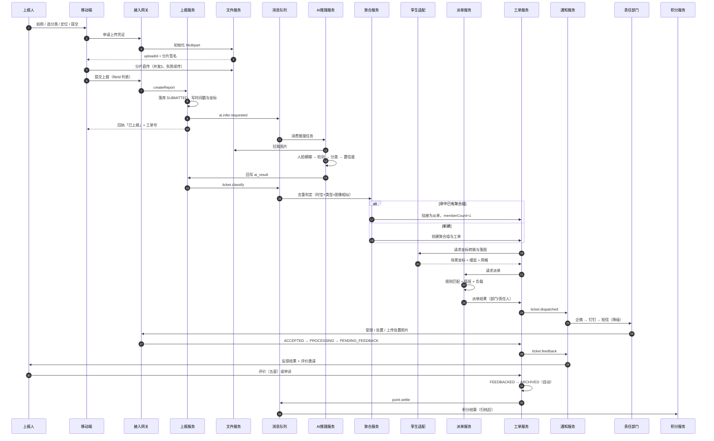

**异常分支（必须显式设计）**

| 分支 | 处理 |
|---|---|
| 图片上传失败 | 工单先提交，`mediaStatus=PENDING`；AI 在图片到齐后触发；超 30 分钟仍无图 → 转人工 |
| AI 超时/失败 | 按用户分类直派，`aiStatus=MANUAL_PENDING`，后台补偿重试 |
| 聚合服务异常 | 降级为"不聚合"，每条上报独立建单（宁可多派，不可丢单） |
| 孪生适配异常 | 使用楼栋中心点落图 + 标记"位置为楼栋级" |
| 派单失败 | 进入待人工调度池 + 管理端红点 |
| 通知全失败 | 同上 + 记录 `notifyFailed` |
| 并发重复提交 | 客户端幂等键 `clientRequestId`，服务端唯一索引 |

## 2.4 数据模型

### 2.4.1 ER 图（核心实体）

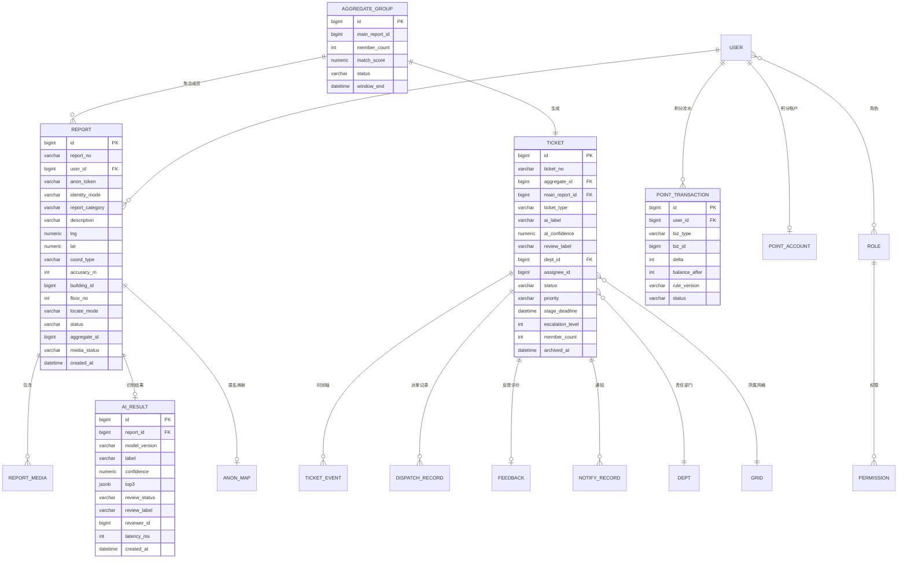

### 2.4.2 关键实体与字段说明

| 实体 | 关键字段 | 设计说明 |
|---|---|---|
| `report`（上报单） | `report_no, user_id, anon_token, identity_mode, report_category, description(≤200), lng/lat/coord_type/accuracy_m, building_id, floor_no, locate_mode, status, aggregate_id, media_status` | **匿名与实名分列存储**（`user_id` 可空，`anon_token` 可空）；坐标必存 `coord_type`；`media_status` 支持"先提交后补传" |
| `report_media` | `report_id, file_id, media_type, sort_no, width, height, duration, sha256, status` | 一报多媒；`sha256` 支持秒传去重 |
| `ai_result` | `report_id, model_version, label, confidence, top3(jsonb), review_status, review_label, reviewer_id, latency_ms` | **AI 原判与人工复核并存**，是训练样本来源 |
| `aggregate_group` | `main_report_id, member_count, match_score, status, window_end` | 聚合组独立实体，`window_end` 控制挂接窗口（1.3.3） |
| `ticket`（工单） | `ticket_no, aggregate_id, main_report_id, ticket_type, ai_label, ai_confidence, dept_id, assignee_id, status, priority, stage_deadline, escalation_level, member_count` | 工单**不存原始描述与坐标**（冗余只存快照），详情从主单读；`member_count` 直接支撑台账"已合并 N 条"展示 |
| `ticket_event`（时间轴） | `ticket_id, event_type, from_status, to_status, operator_id, remark, attachments(jsonb), created_at` | **只追加不改写**，是所有状态变化的唯一真相 |
| `dispatch_record` | `ticket_id, rule_id, dept_id, assignee_id, mode, reason, created_at` | 支持转派/退回历史追溯 |
| `feedback` | `ticket_id, rating(1-5), comment, satisfied(bool), appeal_status` | 对应文档"评价与满意度" |
| `notify_record` | `ticket_id, channel, template_code, receiver_id, result, cost_ms, fail_reason, dedup_key` | 支撑"通知是否真的送达" |
| `dept / grid` | `dept: id,name,parent_id,type`；`grid: id,name,level,parent_id,owner_dept_id,geom` | 网格用 PostGIS `geometry` 存储多边形 |
| `user / role / permission / data_scope` | RBAC + 数据范围 | 见 1.10.1 |
| `point_account / point_transaction` | 账户 + 流水（复式） | 流水是真相，余额可重算 |
| `anon_map` | `report_id, user_id_cipher, key_version, created_at` | 信封加密，独立表 + 独立权限 |
| `audit_log` | `who, when, ip, ua, resource, action, before, after, result, chain_hash` | 哈希链防篡改 |

### 2.4.3 关键枚举字典

| 字典 | 取值 |
|---|---|
| `report_category` 上报分类 | `SAFETY`（安全隐患）、`SUSPICIOUS`（可疑人员）、`FACILITY`（设施损坏）、`EMERGENCY`（紧急求助） |
| `ai_label` AI 标签 | `FIRE_EXIT_BLOCKED`（消防通道占用）、`FACILITY_DAMAGED`（设施破损）、`ILLEGAL_PARKING`（违规停放）、`GARBAGE`（垃圾堆积）、`UNKNOWN` |
| `ticket.status` | `SUBMITTED / ACCEPTED / PROCESSING / PENDING_FEEDBACK / FEEDBACKED / ARCHIVED / REJECTED / CANCELLED / SUSPENDED / MERGED` |
| `identity_mode` | `REAL` / `ANON` |
| `locate_mode` | `GPS` / `MANUAL` / `BLUETOOTH` / `WIFI` |
| `notify.channel` | `WECOM` / `DINGTALK` / `SMS` / `INBOX` |
| `media_type` | `IMAGE` / `VIDEO` / `AUDIO` |

## 2.5 对外接口设计

### 2.5.1 移动端 / 管理端（内部，需登录态）

| 方法 | 路径 | 说明 | 关键字段 |
|---|---|---|---|
| POST | `/api/v1/uploads/token` | 申请上传凭证 | `fileType, size, sha256` → `uploadId, parts[]` |
| POST | `/api/v1/reports` | 提交上报 | `clientRequestId, category, description, mediaFileIds[], lng, lat, coordType, accuracy, buildingId, floorNo, identityMode, anonToken` |
| GET | `/api/v1/reports/{id}` | 上报详情与进度 | `status, timeline[], aiResult, aggregate` |
| POST | `/api/v1/reports/{id}/cancel` | 撤回误报 | `reason` |
| POST | `/api/v1/reports/{id}/materials` | 追加补充材料 | `mediaFileIds[], note` |
| GET | `/api/v1/my/reports` | 我的上报列表 | 分页、状态筛选 |
| GET | `/api/v1/tickets` | 工单台账（管理端） | `type, status, deptId, keyword, page` |
| POST | `/api/v1/tickets/{id}/accept` | 受理 | — |
| POST | `/api/v1/tickets/{id}/process` | 开始处置 / 提交处置结果 | `remark, photos[]` |
| POST | `/api/v1/tickets/{id}/feedback` | 反馈上报人 | `content, attachments[]` |
| POST | `/api/v1/tickets/{id}/archive` | 归档 | — |
| POST | `/api/v1/tickets/{id}/transfer` | 转派 | `targetDeptId, assigneeId, reason` |
| POST | `/api/v1/tickets/{id}/reject` | 退回 | `reasonType, remark` |
| POST | `/api/v1/tickets/{id}/merge` | 手动合并 | `sourceTicketIds[]` |
| POST | `/api/v1/tickets/{id}/split` | 拆分从单 | `reportId` |
| POST | `/api/v1/tickets/{id}/review` | AI 结果人工复核 | `reviewLabel, corrected(bool)` |
| POST | `/api/v1/feedback` | 评价与满意度 | `ticketId, rating, comment` |
| GET | `/api/v1/dashboard/summary` | 首屏指标 | `todayReportCount, typeRatio, heatmap` |
| GET | `/api/v1/stats/*` | 报表 | `dim, period` |
| GET | `/api/v1/points/*` | 积分与排行 | `scope, period` |

### 2.5.2 开放接口（给孪生平台 / 安全大脑 / 工单 OA）

| 方法 | 路径 | 说明 |
|---|---|---|
| GET | `/open/v1/twin/points` | 点位/热力（bbox、zoom、status） |
| GET | `/open/v1/twin/points/{ticketNo}` | 单点详情摘要 |
| GET | `/open/v1/dict/hazard-types` | 隐患类型字典（供安全大脑对齐） |
| POST | `/open/v1/tickets` | 外部系统建单（如 OA 转办） |
| GET | `/open/v1/tickets/{ticketNo}` | 工单状态查询 |
| POST | `/open/v1/callback/ai-result` | 安全大脑回推识别结果（可选，若推理在安全大脑侧） |
| POST | `/open/v1/callback/twin-calibration` | 孪生标定参数变更通知 |

**开放接口统一规范**

```
Headers:
  X-App-Id: 应用标识
  X-Timestamp: 毫秒时间戳（±5 分钟有效）
  X-Nonce: 随机串（防重放）
  X-Signature: HMAC-SHA256(appSecret, method+path+timestamp+nonce+bodySha256)
Response:
  { "code": 0, "message": "ok", "data": {...}, "traceId": "..." }
错误码:
  0 成功 / 40001 参数错误 / 40101 签名失败 / 40301 无权限
  40401 资源不存在 / 42901 限流 / 50001 服务异常
```

### 2.5.3 与三方系统的集成方式

| 系统 | 集成方式 | 方向 | 内容 |
|---|---|---|---|
| 安全大脑 | REST + MQ（可选） | 双向 | 发图推理 / 回推标签与置信度 / 字典同步 |
| 数字孪生平台 | REST + JS SDK | 双向 | 拉楼栋与标定参数；推点位；大屏订阅事件 |
| 工单/OA | REST + Webhook | 双向 | 建单、状态同步、办结回写 |
| 统一身份（CAS/OAuth2） | OIDC / CAS | 单向 | 登录、组织与人员同步 |
| 企微 / 钉钉 | 自建应用 API | 出 | 消息推送、免登 |
| 短信 | 运营商/短信网关 HTTP API | 出 | 验证码、紧急通知 |

## 2.6 技术选型建议

| 层 | 首选 | 理由 | 替代方案 | 国产化/私有化可替换 |
|---|---|---|---|---|
| 小程序 | 原生 WXML 或 Taro3 + TS | 包体小、审核稳、拍照/定位能力直连 | uni-app | — |
| App | Flutter 3.x | 一套代码双端、原生插件成熟、后台任务可控 | React Native / 原生双端 | 鸿蒙原生（ArkTS）需另评估 |
| 管理端 Web | Vue 3 + TS + Vite + Element Plus | 团队熟悉、生态好、私有化无外部依赖 | React + AntD | — |
| 大屏可视化 | Three.js / Cesium（或对接孪生引擎 SDK） | 与孪生平台解耦、Web 端零安装 | UE5 像素流（重） | — |
| 后端 | Java 17 + Spring Boot 3 | 生态成熟、招人容易、私有化交付经验多 | Go（性能好、部署轻） | 东方通 TongWeb、宝兰德 |
| 数据库 | PostgreSQL 15 + PostGIS | 空间查询（网格/点在面内）原生支持，省一个 GIS 组件 | MySQL 8 + 自研网格 | 人大金仓 KingbaseES、达梦 DM8 |
| 缓存 | Redis 7 | 榜单 ZSet、会话、幂等键 | — | 东方通缓存、TongRDS |
| 消息队列 | RabbitMQ | 轻量、延迟队列好用、单校规模足够 | Kafka（吞吐更高、运维更重） | 东方通 TongLINK/Q |
| 对象存储 | MinIO | S3 兼容、私有化标准、支持分片 | Ceph / 华为 OBS 私有化 | 杉岩、XSKY |
| 向量检索 | pgvector | 与业务库同源，少一个组件 | Milvus（大规模） | — |
| AI 推理 | YOLOv8/RT-DETR + 分类模型，ONNX Runtime / TensorRT | 私有化、可控、成本低 | PaddleDetection（国产化友好） | 昇腾 CANN + MindSpore；寒武纪 |
| 规则引擎 | 自研规则表 + 受限表达式 | 简单可控，避免引入 Drools 的重量 | Drools / LiteFlow | — |
| 监控 | Prometheus + Grafana + Loki | 私有化标准组合 | Zabbix | — |
| 部署 | Docker Compose（最小）/ K8s（高可用） | 单校首选 Compose，运维 0 学习成本 | K3s | 麒麟 OS + 鲲鹏/飞腾 |
| 网关 | Nginx + 自研轻量网关（鉴权/限流） | 简单可靠 | APISIX / Kong | — |

**选型总原则**：**组件越少越好**。单校私有化最大的隐性成本不是开发，而是**运维与故障排查**——每多一个中间件，就多一个"半夜打电话来说系统打不开"的可能。因此刻意用 PostGIS 替代独立 GIS、用 pgvector 替代 Milvus、用规则表替代 Drools。

## 2.7 部署架构

### 2.7.1 最小可用拓扑（单校 P0）

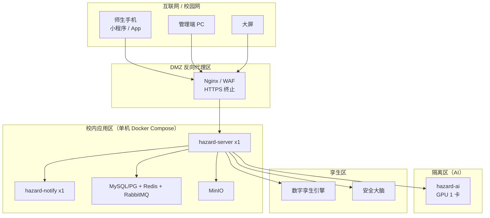

**最小配置建议**：8C/32G/1TB SSD + 1 张推理卡（如 T4/3090/昇腾 310P）；单机即可支撑万级师生。

### 2.7.2 高可用拓扑（P1/P2）

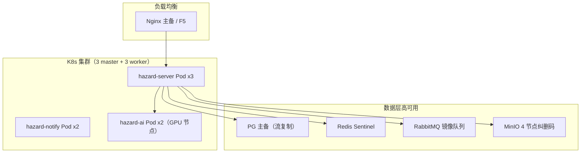

### 2.7.3 网络分区与"数据不出校"物理边界

| 区域 | 部署内容 | 出入规则 |
|---|---|---|
| 互联网/校园网 | 终端 | 仅 HTTPS 到 DMZ |
| DMZ | Nginx/WAF、静态资源 | 只放行 443；不允许直连数据库 |
| 校内应用区 | 业务服务、DB、Redis、MQ、MinIO | 仅接受 DMZ 转发；不出校 |
| 隔离区（AI） | 推理服务 + 模型文件 | 仅内网调用；**无外网出口**（模型更新走离线导入） |
| 孪生区 | 孪生引擎、安全大脑 | 内网互通 |
| 出网白名单 | 短信网关、企微/钉钉 API | 仅出站 443，仅允许域名白名单；**只发最小消息体** |

**物理边界声明（可写入验收文档）**：业务数据、媒体文件、模型权重、日志均存放于校内机房；系统运行不依赖任何公网 SaaS；外部通道仅承载"工单号 + 短链 + 模板文案"，不含照片、坐标与个人信息明文。

## 2.8 非功能设计

### 2.8.1 并发量级估算方法

```
峰值 QPS ≈ 师生总数 × 年人均上报次数 × 集中系数 ÷ 峰值时长(秒)
示例：20,000 人 × 2 次/年 × 40%（集中在开学两周） ÷ (14天 × 8h × 3600s)
     ≈ 16,000 ÷ 403,200 ≈ 0.04 QPS（均值）
峰值系数 ×20 → 约 0.8 QPS
读请求（查进度/台账）约为写的 30 倍 → 约 24 QPS
```

**结论**：单校场景下**并发压力极小**，架构瓶颈不在 QPS，而在：
1. **AI 推理吞吐**（单图 200–800ms，GPU 2 并发 → 约 3–8 张/秒）；
2. **图片上传带宽**（开学季瞬时并发上传）；
3. **报表查询**（全表扫描会拖垮业务库）。

因此优化重点放在**异步化、限流、预聚合**，而不是分布式改造。

### 2.8.2 图片存储容量估算

```
单条上报：3 张 × 400KB(压缩后) ≈ 1.2MB
年上报量：20,000 条 → 24GB/年
视频（按 5% 上报含 1 段 10MB）→ 10GB/年
缩略图：3 × 40KB × 20,000 ≈ 2.4GB/年
3 年合计 ≈ 110GB（含副本 ×2 → 220GB）
```

**结论**：1TB 起步足够；采用**生命周期策略**（原片 3 年、预览片 1 年），并对过期数据做冷备归档，避免无限增长。

### 2.8.3 可用性与容灾

| 项 | 目标（【设计建议】） | 手段 |
|---|---|---|
| 可用性 | 99.5%（最小）/ 99.9%（HA） | 多副本、健康检查、自动重启 |
| RPO | ≤15 分钟 | PG 流复制 + WAL 归档 |
| RTO | ≤2 小时 | 备份恢复脚本 + 演练 |
| 备份 | 每日全量 + 每小时增量，保留 30 天 | 异机保存，加密 |
| 演练 | 每学期 1 次恢复演练 | 记录演练报告 |

### 2.8.4 监控告警

| 类别 | 指标 | 阈值（建议） |
|---|---|---|
| 应用 | 接口 P95、错误率、JVM/GC | P95 >1s 或错误率 >1% 告警 |
| 队列 | 积压深度、消费延迟 | AI 队列 >50 或延迟 >60s |
| 数据库 | 连接数、慢查询、复制延迟 | 慢查询 >500ms 记录 |
| 存储 | 磁盘使用率、MinIO 可用性 | >80% 告警 |
| 业务 | 待受理超时数、通知失败率、派单失败数 | 任一 >0 即提醒 |
| AI | 推理失败率、平均延迟、转人工率 | 失败率 >5% 告警 |

### 2.8.5 灰度与升级

- **应用升级**：滚动更新（K8s）或蓝绿（Compose 下用 Nginx upstream 切换）。
- **数据库变更**：Flyway 版本化脚本，**只增不删**（先加列、双写、再切读、最后清理），保证可回滚。
- **模型灰度**：按 `reportId % 100` 分流；对比"转人工率/纠偏率"，达标再放量。
- **配置灰度**：派单规则、积分规则支持"草稿 → 预览影响面 → 生效"，避免一改规则全乱。

## 2.9 关键难点与风险

| # | 难点 | 风险表现 | 应对 |
|---|---|---|---|
| 1 | **坐标落图偏移** | 点位飘到隔壁楼，大屏不可信 | 控制点标定 + `coordType` 显式化 + 标定版本化 + 落图前可视化校验工具 |
| 2 | **弱网上传失败** | 师生在楼道/地下车库提交失败，弃用系统 | 本地队列 + 分片续传 + 先提交后补传 + 手动定位兜底 |
| 3 | **AI 准确率不足** | 误判导致派错部门，部门不信任系统 | 三档阈值 + 低置信转人工 + 复核纠偏回流 + 灰度发布 + 保留用户分类兜底 |
| 4 | **去重误判** | 把两处不同隐患合并，漏处置（安全事故风险） | 硬门槛（空间/类型否决）+ 人工拆分 + 合并记录可解释 + 阈值可调 |
| 5 | **多端一致性** | 小程序与 App 字段/状态不一致，客服解释不清 | OpenAPI 契约 + 生成客户端 + 状态字典单一来源 + 契约测试 |
| 6 | **部门甩单** | 工单在部门间空转，超时率飙升 | 退回原因分类 + 退回率看板 + 3 次退回升级校级 + 兜底部门 |
| 7 | **私有化交付成本** | 每校一套环境，实施人力被拖垮 | 组件最少化 + 一键部署脚本 + 配置化（规则/字典/模板）+ 标准实施手册 |
| 8 | **匿名合规** | 被质疑"假匿名"或"过度采集" | 双通道身份 + 密钥分离 + 解密双人审批 + 隐私政策明示 + 不涉人脸的技术保障 |
| 9 | **通知到达率** | 派单消息没看到，工单躺平 | 三通道降级 + 回执 + 未读催办 + 待人工调度池兜底 |
| 10 | **三方联调扯皮** | 孪生/AI 接口反复变更，工期失控 | 契约先行 + 统一环境 + 总架构师裁决 + 适配层隔离 + 本地缓存降级 |

## 2.10 分阶段实施路线

> 不承诺具体工期，按"阶段 + 交付物 + 验收标准"组织；每阶段结束需甲方确认后再进入下一阶段。

### 阶段一：最小可用（MVP）——"能报、能派、能闭环"

| 交付 | 内容 |
|---|---|
| 移动端 | 小程序（上报、拍照、定位、分类、匿名/实名、我的上报、撤回、追加材料） |
| 后端 | 上报、工单（五段状态机）、派单（规则表）、通知（企微+短信） |
| 管理端 | 工单台账（6 字段）、详情、受理/处置/反馈/归档 |
| 集成 | 统一身份登录、MinIO、孪生落图（接口方式） |
| 数据 | 核心表 + 字典 + 审计基础 |

**验收标准**：师生可完成"拍照→提交→看到进度"；处置人员可完成"受理→处置→反馈→归档"；大屏能看到点位；台账可筛选；超时能预警。

### 阶段二：完整闭环——"AI 加持 + 去重 + 多渠道"

| 交付 | 内容 |
|---|---|
| AI | 推理服务、四类识别、置信度、人工复核、低置信转人工 |
| 去重 | 聚合判定、主从单、已合并 N 条、人工拆分 |
| 通知 | 钉钉接入、降级链、频控、模板管理 |
| 积分 | 账户、流水、规则配置、排行榜、文明宿舍/评优导出 |
| 分析 | 首屏三指标、类型占比、区域热力、部门绩效报表 |
| 运维 | 监控告警、备份、审计查询 |

**验收标准**：AI 转人工率与准确率达到约定值（**需甲方确认指标**）；重复上报可自动合并且可人工拆分；三通道通知可达；积分可结算并可查榜。

### 阶段三：智能增强——"更准、更快、更省"

| 交付 | 内容 |
|---|---|
| 模型 | 纠偏回流训练、模型灰度、难例挖掘、季度迭代机制 |
| 落图 | 室内定位（WiFi/BLE 试点）、楼层自动推荐、三维点位交互 SDK 增强 |
| 智能 | 高频隐患点位预测、治理建议、相似工单推荐处置方案 |
| 体验 | App 端（后台续传、离线草稿）、语音转文字、无障碍适配 |
| 交付 | 一键部署包、二次开发文档、源码级交付与培训 |

**验收标准**：模型指标较阶段二提升（纠偏率下降）；室内点位可落到楼层房间；交付物齐全可通过第三方评审。

---

# 第三部分　关键设计取舍（评审要点）

| # | 取舍 | 选择 | 代价 | 为什么这么选 |
|---|---|---|---|---|
| 1 | 微服务 vs 模块化单体 | **模块化单体 + AI/通知独立** | 单模块无法独立扩缩容 | 单校一套、并发极低；组件越少，私有化交付与运维越可控。模块边界已按未来拆分预留 |
| 2 | 小程序跨端框架 vs 原生 | **原生/Taro 编译**，App 用 Flutter | 两套 UI 代码 | 拍照/定位/后台续传是体验命门，跨端框架在弱网与后台能力上不可控 |
| 3 | AI：公网大模型 vs 私有化小模型 | **私有化检测+分类为主，VLM 可选增强** | 需自建标注与训练 | "数据不出校"是硬约束，公网 API 直接违规；小模型可控、可解释、成本低 |
| 4 | AI 同步 vs 异步 | **异步（MQ + 结果表 + 补偿）** | 状态短暂不一致 | 推理慢且会失败，同步会把提交接口拖垮；"先回执、后补结果"体验更好 |
| 5 | 聚合"合并成一条" vs "主单+从单" | **主单+从单（保留全部原始上报）** | 数据模型更复杂 | 原始上报是证据与统计基础；只对外产生 1 个工单即可满足"避免重复派单" |
| 6 | 落图：客户端转换 vs 服务端统一 | **服务端统一转换 + 标定版本化** | 多一次调用 | 坐标是全局一致性问题，客户端各转各的必然漂移；版本化保证历史点位不跑偏 |
| 7 | 匿名：完全匿名 vs 实名 | **双通道（业务匿名 + 审计可追溯）** | 需密钥管理与审批流程 | 纯匿名无法防刷与追责，纯实名没人敢报；双通道是唯一能同时满足合规与业务的做法 |
| 8 | 通知：只发企微 vs 三通道降级 | **三通道 + 降级 + 频控** | 对接成本与短信费用 | 派单不到达=工单躺平，这是校园系统最常见的失效点 |
| 9 | 分析：上数仓 vs 只读副本 | **只读副本 + 预聚合** | 复杂分析能力有限 | 年万级数据量，数仓是过度设计；预聚合足以支撑看板与报表 |
| 10 | 权限：只在应用层过滤 vs 下沉 SQL | **DAO 层强制注入数据范围** | 开发略繁琐 | 前端隐藏等于没做；等保与审计要求数据权限必须真实生效 |

---

# 第四部分　需与甲方确认的清单（不确认不能进开发）

| # | 待确认项 | 影响 | 建议默认值 |
|---|---|---|---|
| 1 | 各级超时时限（受理/处置/反馈/归档） | 状态机、预警、考核 | 30min / 4h / 2h / 24h |
| 2 | 升级层级与通知对象 | 通知、督办 | 3 级（责任人→部门负责人→校级） |
| 3 | 是否强制单次 ≥3 张图 | 提交门禁、紧急求助体验 | 支持 ≥3 张但不强制 |
| 4 | 角色权限矩阵 | 账号体系、菜单 | 见 1.10.1 建议表 |
| 5 | 积分规则与分值、单日上限 | 激励效果、防刷 | 见 1.8.1 |
| 6 | 数据与媒体留存年限 | 存储容量、合规 | 业务 3 年，媒体原片 3 年 |
| 7 | 等保级别 | 安全投入 | 二级 |
| 8 | 是否允许人形检测（用于脱敏） | 模型流水线 | 允许检测但不出特征 |
| 9 | 匿名追溯的审批流程与告知文案 | 合规 | 双人审批 + 隐私政策明示 |
| 10 | 责任部门映射细则（宿舍区垃圾归谁） | 派单准确率 | 见 1.5.1 规则表 |
| 11 | 是否接入统一身份（CAS/OIDC） | 登录与组织同步 | 建议接入 |
| 12 | 短信通道与费用承担方 | 通知可达性 | 校方提供网关 |
| 13 | 大屏由谁提供引擎与标定 | 落图精度 | 孪生平台提供 |
| 14 | AI 验收指标（准确率/转人工率） | 阶段二验收 | 准确率 ≥85%、转人工率 ≤25% |

---

## 附：与产品方案的逐条对照（自检表）

| 文档能力 | 本文落点 | 状态 |
|---|---|---|
| App + 小程序双端 | 1.1.1 | ✅ |
| 一键拍照、≥3 张、视频/语音/文字 200 字 | 1.1.2 / 1.1.3 / 2.4.2 | ✅ |
| 自动定位与时间戳 | 1.1.4 | ✅ |
| 四类上报分类 | 2.4.3 | ✅ |
| 匿名/实名、实名关联积分 | 1.1.5 / 1.8 | ✅ |
| GPS 孪生精准落图 | 1.4 / 2.5.2 | ✅ |
| AI 四类识别 + 置信度 + 人工复核 | 1.2.1–1.2.4 | ✅ |
| 仅轻量非敏感、不涉人脸 | 1.2.5 | ✅ |
| 标准接口层 HTTP/REST | 2.5 | ✅ |
| 保卫处/后勤/宿管自动派单 | 1.5 | ✅ |
| 五段闭环 + 超时预警升级 | 1.6 | ✅ |
| 多报去重聚合"已合并 3 条" | 1.3 | ✅ |
| 企微/钉钉/短信 | 1.7 | ✅ |
| 评价与满意度、追加材料、撤回误报 | 1.1.6 / 1.6.4 | ✅ |
| 管理端 6 字段台账 + 4 视图 | 2.4.2 / 2.5.1 | ✅ |
| 今日上报/类型占比/区域热力 | 1.9 | ✅ |
| 积分/荣誉/评优/文明宿舍/志愿时长/排行榜 | 1.8.3 | ✅ |
| 权限分级/操作留痕/加密传输 | 1.10 | ✅ |
| 私有化、数据不出校 | 1.10.4 / 2.7.3 | ✅ |
| 统一数据模型 + 源码级/SDK 级 + 同一主体 | 1.11 | ✅ |
